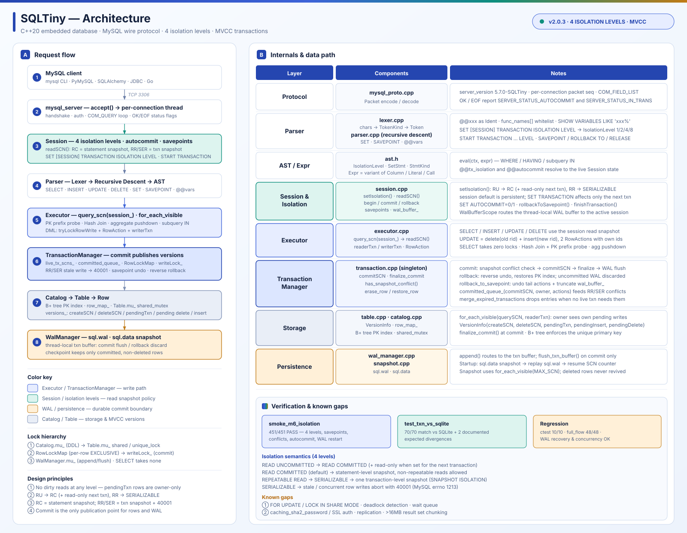

# SQLTiny — Lightweight Embedded Database · MySQL Protocol Compatible

> **Current version `v2.2.1` (2026-11-21)** · The version number is maintained in `CMakeLists.txt` (`project(SQLTiny VERSION 2.2.1)`), `vcpkg.json` (`version-string`) and the startup banner in `src/main.cpp`. The wire protocol still reports `5.7.0-SQLTiny` for MySQL client compatibility — that string is unrelated to the product version.
>
> v2.2.1 adds an optional **MSVC AddressSanitizer build** (`windows-asan` preset) and backs the stateful Hypothesis fuzzing in the sibling test suite. See "What's new in v2.2.1" below.

**SQLTiny** is a lightweight relational database written from scratch in modern C++20, with its core design inspired by [HSQLDB](http://hsqldb.org/). It additionally exposes the **MySQL Wire Protocol**, so standard MySQL clients (`mysql` CLI, Navicat, DBeaver, Connector/J, PyMySQL, DBX/dbExpress) can connect directly.

> The full project plan lives in [`CODEPLAN.md`](./CODEPLAN.md) — architecture mapping, technology choices and milestone acceptance are all documented there.

> 🌐 Language: **English** · [简体中文](./README.md)

---

## ✨ Highlights

| Feature | Description |
|---|---|
| 🧠 **Pure C++20** | No Java / SQLite / RocksDB dependency |
| 🗄️ **Embedded first** | In-process C++ calls or TCP client connections — two modes |
| 🎯 **MySQL protocol compatible** | PyMySQL / mysql CLI / Navicat / SQLAlchemy / **dbExpress (DBX) drivers** connect directly; handshake + type inference + NULL codec complete |
| 🔧 **Server-side prepared statements** | Full binary protocol for `COM_STMT_PREPARE / EXECUTE / CLOSE / RESET / SEND_LONG_DATA` |
| 🗂️ **information_schema** | Virtual tables such as SCHEMATA / TABLES / COLUMNS — third-party tool metadata browsing works out of the box |
| 🗃️ **Multi-database catalog** | CREATE/DROP/USE DATABASE with per-database table registries |
| ⚡ **B+ tree in-memory index** | Primary key index is a hand-written B+ tree (since v2.0.0); point lookup O(logₙ) · leaf-chain ordered scan |
| 🪶 **Lightweight** | Single database file, millisecond startup, only dependency is fmtlib; **statically linked** (`x64-windows-static`), no `fmt.dll` or VC runtime DLL required |
| 🧪 **ASan build** | Optional `windows-asan` preset (MSVC `/fsanitize=address`, no Clang/LLVM) for overflow/crash detection and fuzzing |

---

## 🏛️ System Architecture



> 🎨 **Color semantics**: indigo = execution / transaction write path · teal = Session and isolation levels (read-snapshot policy) · amber = WAL and persistence (commit boundary) · slate = Catalog/Table storage and MVCC versions
>
> 🔒 **Lock hierarchy**: Catalog.mu_ (DDL) → Table.mu_ shared_lock (concurrent SELECT readers) / unique_lock (exclusive DML) → RowLockMap (row-level conflict detection) → TransactionManager.writeLock_ (commit boundary) → WalManager.mu_ (WAL file I/O)
>
> 🧊 **MVCC**: SELECT takes no locks at all; `for_each_visible(querySCN, readerTxn)` filters by `createSCN/deleteSCN` and `pendingTxn`. Uncommitted rows are visible only to their owning transaction; `finalize_commit` publishes them at commit.

---

## 🆕 What's new in v2.2.1 (MSVC ASan build, 2026-11-21)

No SQL semantics or protocol behavior changes; adds an optional **MSVC AddressSanitizer** build and backs the stateful Hypothesis fuzzing in the external test suite.

- **`windows-asan` preset**: no Clang/LLVM required; `SQLTINY_ASAN=ON` adds `/fsanitize=address /Zi` to every target, output under `build-asan/RelWithDebInfo/`
- **Runtime DLL deployment**: POST_BUILD copies `clang_rt.asan_dynamic-x86_64.dll` next to every executable, so Python scripts can spawn build outputs without touching `PATH`
- **fmt annotation workaround**: the prebuilt `fmt.lib` is not ASan-instrumented; `_DISABLE_VECTOR_ANNOTATION` / `_DISABLE_STRING_ANNOTATION` avoid LNK2038 while keeping heap/stack overflow detection
- **Validation baseline** (ASan server): SLT **1184 / PASS 1133 / GAP 51 / FAIL 0**, protocol **42/42**, persistence **15/15**; the sibling `SQLTinySLT` Hypothesis fuzzer runs 100+ examples / ~6000 statements with **0 crashes / 0 protocol desyncs / 0 oracle failures**

Boundary: UBSan and libFuzzer coverage instrumentation are Clang-only and unavailable under MSVC; ASan covers memory errors and crashes.

---

## 🆕 What's new in v2.2.0 (command-line import / dump, 2026-11-17)

`sqltiny_server.exe` gains a batch mode: instead of starting the network server, it imports a SQL script into (or exports from) the database under `--data-dir`, then exits.

**Import `--import FILE`**
- Streams the script, supporting `--` / `#` line comments, `/* ... */` and MySQL `/*! ... */` conditional comments, single/double/backtick quoting with escapes, and `DELIMITER`
- Skips mysqldump's `LOCK TABLES` / `UNLOCK TABLES`; accepts column-level `COLLATE` / `CHARACTER SET` / `ON UPDATE` and table-level `AUTO_INCREMENT=n` in any position
- Commits statement by statement; `--import-continue-on-error` keeps going after failures, `--import-quiet` suppresses progress, `--import-then-serve` starts the server after importing

**Export `--dump FILE`**
- Emits `CREATE DATABASE IF NOT EXISTS` / `USE` / `DROP TABLE IF EXISTS` / `CREATE TABLE` (primary keys, defaults, AUTO_INCREMENT cursor) / multi-row `INSERT`
- `--dump-database` / `--dump-table` filter databases and tables, `--dump-no-create` / `--dump-no-data` / `--dump-no-drop` trim the output, `--dump-batch-rows N` sets rows per INSERT
- `--dump -` writes to stdout while engine and import/export logs go to stderr, so redirection yields pure SQL

**Validation**: new `smoke_cli_io` **40 checks / 0 FAIL** (comments, escapes, `DELIMITER`, `LOCK TABLES` skipping, dump→import round trip, defaults / auto-increment cursor); manual verification of mysqldump-style import, `--dump -` redirection and `--import-then-serve`.

---

## 🆕 What's new in v2.1.0 (benchmark top-query optimizations, 2026-11-16)

Optimized the top bottlenecks from `benchmark/employees_query_detail.csv`, no FAIL introduced.

- rank1 CTE `MAX(salary) GROUP BY emp_no`: 10.3s → **1.15s** (single-table GROUP BY streaming aggregation)
- rank2 `COUNT(*) WHERE salary > (SELECT AVG(salary))`: 8.17s → **0.77s** (non-correlated scalar subquery constant folding restores fast_agg)
- rank20 `COUNT(*) WHERE emp_no IN (SELECT ...)`: 0.67s → **0.43s** (IN candidate set hash index)
- **Validation**: SLT **1184 / PASS 1132 / GAP 52 / FAIL 0** (no regression); compare_employees **39/39 MATCH**; 10 GROUP BY boundary cases all MATCH

---

## 🆕 What's new in v2.0.9 (aggregate pushdown enhancement, 2026-11-16)

Driven by the benchmark level-1/level-2 comparison: 3-table JOIN with `ROUND(AVG(...))` + `HAVING` dropped from **18.7s to ~5s** (~4x), no FAIL introduced.

- **Pushdown criteria extended** (`executor.cpp`): scalar functions wrapping aggregates (`ROUND(AVG(x))`) and `HAVING` now push down; `HAVING` aggregates matched by signature to already-accumulated values; fallback to the generic path when a `HAVING` aggregate is not projected
- Also fixed `Expression::clone()` missing `is_window`/window fields, and fused raw-aggregate index alignment
- **Validation**: SLT **1184 / PASS 1132 / GAP 52 / FAIL 0** (no regression); compare_employees **39/39 MATCH**

---

## 🆕 What's new in v2.0.8 (P1-b DML dialect + DDL core, 2026-11-16)

Driven by the P1-b batch of the standalone sqllogictest suite: GAP 78 → **52**, still zero FAIL.

- **INSERT dialect**: `VALUE` (singular), `() VALUES()`, `INSERT ... SET`, `INSERT IGNORE`, `REPLACE INTO`, `ON DUPLICATE KEY UPDATE`
- **UPDATE/DELETE**: `ORDER BY ... LIMIT`, multi-table `UPDATE ... JOIN ... SET`, `TRUNCATE TABLE`
- **AUTO_INCREMENT**: table option `AUTO_INCREMENT=n`, non-PK auto-increment columns
- **DDL core**: `CREATE TABLE ... AS SELECT` / `LIKE`, `TEMPORARY`, `VIEW`, `CREATE INDEX`, `ALTER TABLE ... ADD COLUMN`, `RENAME TABLE`, DDL implicit commit
- **Validation**: SLT **1184 items · PASS 1132 / GAP 52 / FAIL 0**, protocol 42/42, persistence 15/15

---

## 🆕 What's new in v2.0.7 (P1-a date/time module, 2026-11-16)

Driven by the P1-a batch of the standalone sqllogictest suite: **14 date/time GAPs closed**, GAP 92 → **78**, still zero FAIL.

| Category | Functions |
|---|---|
| Date arithmetic | `DATEDIFF` · `DATE_ADD(d, INTERVAL n UNIT)` · `DATE_SUB` · `LAST_DAY` |
| Extraction / formatting | `DAYOFWEEK` (1=Sunday) · `WEEK` · `DATE_FORMAT` (`%Y/%m/%d/%H/%i/%s`) · `STR_TO_DATE` |
| Timestamps | `UNIX_TIMESTAMP` · `FROM_UNIXTIME` |
| Current time | `CURTIME` · parenthesis-free `CURRENT_DATE` / `CURRENT_TIMESTAMP` / `CURRENT_TIME` |

Implementation notes: lexer gained `INTERVAL`; the parser folds `INTERVAL n UNIT` into `__interval(n, 'UNIT')` and parenthesis-free `CURRENT_*` tokens into function calls (otherwise they were treated as columns and evaluated to NULL). `expr.cpp` now uses one date parser plus civil-days arithmetic (with the 1970 epoch offset) for YEAR/MONTH/QUARTER/DAY/WEEK/HOUR/MINUTE/SECOND, clamping to month length. `DATETIME - DATETIME` yields a seconds difference (`NOW() - NOW()` = 0). Also fixed a P0-introduced 1055 regression: bare `dept_name` in SELECT now matches qualified `GROUP BY d.dept_name`.

Verification: SLT **1184 · PASS 1106 / GAP 78 / FAIL 0** (`03_datetime.slt` 45/45, all 14 `gap` markers removed); protocol **42/42**; persistence **15/15**; `compare_employees.py` **39/39 MATCH**.

## 🆕 What's new in v2.0.6 (MySQL semantic compatibility, 2026-11-16)

Driven by the same sqllogictest suite: **FAIL 67 → 0**, PASS 971 → 1092, GAP 146 → 92. Covers value semantics (NULL ordering, three-valued logic, implicit casts), protocol and SQL error codes, RIGHT JOIN / comma joins, window aggregates, information_schema metadata, and string/numeric functions. Protocol 42/42; persistence 15/15.

---

## 🆕 What's new in v2.0.5

`tests/benchmark/compare_employees.py` grew from 14 to **39 queries** (basic 14 / nested subqueries 10 / WITH·CTE 4 / complex 11) executed against the same dataset on MySQL 3306 and SQLTiny. Three classes of problems surfaced and were all fixed.

### 1. Silent correctness bugs (wrong results, no error)

| Bug | Symptom | Fix |
|---|---|---|
| GROUP BY alias ignored | `GROUP BY g` evaluated an unknown column as NULL, collapsing everything into one group | Group keys resolve back to the SELECT expression |
| Aggregate nested in a function | `ROUND(AVG(salary),2)` returned `0` | Recursive evaluation inside aggregate context |
| Date functions missing | `YEAR(hire_date)` silently NULL, per-year grouping collapsed | YEAR/MONTH/DAY and friends implemented |

### 2. Syntax gaps closed

WITH / CTE (including multiple CTEs), `WITH RECURSIVE`, scalar subqueries (WHERE comparison and SELECT list, correlated included), `EXISTS`, FROM derived tables, `COUNT(DISTINCT)`, `BETWEEN`, and **window functions `ROW_NUMBER() OVER (PARTITION BY … ORDER BY …)`**.

### 3. Performance fixes

| Problem | Before | After |
|---|---|---|
| GROUP BY bucketing was a linear scan, O(groups²) | salaries 300K groups **timed out at 100s** | **3.80s** (`unordered_map`) |
| Correlated `IN` subquery re-scanned the inner table per outer row | **timed out at 100s** | **0.096s** (outer-column equality now probes the PK prefix) |
| Recursive CTE iterated over the accumulated full set (exponential growth under UNION ALL) | **timed out at 100s** | **0.001s** (previous-round delta working set) |
| Correlated subquery results were cached as if uncorrelated | only the first row returned (2 MISMATCH) | decorrelation now sets `outer_used` |

### 4. Final result (39 queries, MySQL vs SQLTiny)

| Category | Count | Result | MySQL | SQLTiny |
|---|---|---|---|---|
| Basic | 14 | 14 MATCH | 14.00s | **5.45s** |
| Nested | 10 | 10 MATCH | 3.26s | 5.84s |
| WITH | 4 | 4 MATCH | 1.42s | 4.13s |
| Complex | 11 | 11 MATCH | 9.82s | 12.73s |

`SUMMARY: fails = 0`. The comparison script now uses **one connection per query with a 100s timeout**, so a single timeout can no longer invalidate the connection and cascade into `(0,'')` false errors — most of the 11 initial ST-ERRs were exactly that.

### 5. Tests

- New `smoke_sql_keywords` (**649 PASS**) and `smoke_sql_syntax` (**160 PASS / 15 GAP**); CTest now has **12 targets**
- `smoke_m25_e2e` now connects to **3307** instead of 3306, so it no longer fails auth against a password-protected MySQL
- CTest **12/12** green

---

## 🆕 What's new in v2.0.4

This release brings two improvements: a **single-pass fused aggregate path** and **UNION / UNION ALL support**.

### 1. Fused aggregate fast path (one scan)

Previously `SUM(salary)` went through the generic aggregate path: 2.8M rows were copied three times (`left_rows` / `candidate_rows` / `buckets`), `build_ctx` + `eval(column)` ran once per row during scanning and again during aggregation — **2.97s**. `WHERE salary>100000` did the same with a per-row `eval` predicate and then materialized 94,696 rows — **0.774s**.

The new path resolves column offsets and predicate operands once before scanning, then filters and accumulates directly inside the `for_each_visible` callback — no intermediate rows. The trigger is deliberately narrow: single table, no JOIN/GROUP BY/HAVING/DISTINCT/ORDER BY/LIMIT, projections limited to simple aggregates (`COUNT(*)` / `COUNT|SUM|AVG|MIN|MAX(column)`), and a WHERE clause decomposable by AND into `column op literal` comparisons. A PK equality eligible for index probing still takes priority. Integer comparisons use direct `int64` compare within the lossless 2^53 range, avoiding a `try_to_double` per operand.

| Query (employees, 3.92M rows, Release, mean of 5 runs) | v2.0.3 | v2.0.4 | MySQL 3306 |
|---|---|---|---|
| `SELECT SUM(salary) FROM salaries` | 2.969s | **0.352s** (~8.4x) | 0.33s |
| `SELECT COUNT(*) FROM salaries WHERE salary>100000` | 0.774s | **0.248s** (~3.1x) | 0.28s |
| `COUNT + SUM + AVG + MIN + MAX` combined | — | 0.422s | — |
| `SUM(salary) WHERE emp_no=10001` (PK probe) | 0.000s | 0.000s (path unchanged) | — |

Empty-set NULL semantics (`SUM/AVG/MIN/MAX → NULL`, `COUNT → 0`), string MIN/MAX, qualified column names, literal-on-left (`100000<salary`), and multiple AND predicates were all checked against MySQL. Cross-type string literals (`salary>'100000'`) retain the pre-existing behavior.

### 2. UNION / UNION ALL

The AST already had `set_op` / `set_right` fields, but the parser and executor never wired them up. This release completes the path:

- `parser.cpp`: parses `UNION [ALL | DISTINCT] SELECT ...`; the right branch is recursive, so chained UNIONs work
- `executor.cpp/.h`: `exec_select` is split into a UNION wrapper plus `exec_select_body`; UNION ALL concatenates, UNION deduplicates; trailing ORDER BY/LIMIT on the right branch applies to the whole UNION; ragged rows are padded with NULLs
- Bonus: `ORDER BY 1` numeric positional references (common MySQL syntax, previously missing)

Three-way comparison (employees dataset, mean of 3 runs):

| Query | MySQL 3306 | tcdb 3308 | SQLTiny 3307 |
|---|---|---|---|
| `COUNT(employees) UNION ALL COUNT(salaries)` | 0.03s | 0.00s* | 0.26s |
| `salaries>100000 UNION ALL salaries<=100000` | 0.38s | 0.00s* | 0.58s |
| 20K-row employee result set UNION ALL | 0.02s | 0.02s | 0.26s |
| GROUP BY results UNION ALL | 0.10s | 0.00s* | 0.64s |
| UNION dedupe / chaining / ORDER BY+LIMIT | — | 16384-row limit error | matches MySQL |

\* tcdb's plain `COUNT(*)` queries appear to hit a result cache; do not read them as real scan times. SQLTiny executes branches sequentially; simple aggregate branches use the new fast path, while GROUP BY branches still use the generic path — the main source of the remaining gap.

### Regression

`ctest` 9/10 (`smoke_m25_e2e` hardcodes port 3306, which is now a password-protected MySQL — environmental auth failure); `test_full_flow` 48/48, `test_vs_sqlite` all scenarios consistent, `test_stmt_prepare` 7/7 — all pointed at 3307 and passing.

---

## 🆕 What's new in v2.0.3

Primary-key point lookups used to take the same path as any other query: full table scan over 300K / 2.8M rows with per-row `eval` of the predicate, so `SELECT COUNT(*) FROM employees WHERE emp_no=10001` cost **74 ms**. This release routes "leading primary-key column equals a constant" straight to a **primary-key prefix index probe**, no full scan.

### Two changes

1. **Executor: `WHERE pk = constant` → index prefix probe** (`src/executor/executor.cpp`). `WHERE` is split on `AND` into conjuncts; if one has the form "leading PK column of the base table = literal" (either operand order), the executor uses `for_each_by_pk_prefix` to visit only matching keys. The predicates are still re-evaluated row by row in the callback, so semantics match the full-scan path exactly. To avoid missing rows across types, only **same type family** literals are accepted (integer column with integer literal, string column with string literal, etc.) — cross-type comparisons keep the full scan, since the index compares strictly by stored type while WHERE evaluation allows implicit conversion. `IS NULL` and non-literals (placeholders, expressions) never take part in the probe.
2. **Storage: logical-delete fallback guard** (`src/storage/table.{h,cpp}`). An MVCC logical delete **immediately** removes the key from the primary index while the physical row stays in `row_map_`. In that state an index scan is no longer a superset of a full scan (rows visible to older snapshots, or rows with an uncommitted delete, are missing from the index). Hence a new `dead_rows_` counter and `has_dead_rows()` (incremented on first logical delete, decremented on physical purge / rollback restore); whenever logical-delete history exists, point lookups **fall back to a full scan automatically**, preserving visibility semantics across all four isolation levels.

### Measurements (employees, 3.92M rows, Release, mean of 5 runs)

| Query | v2.0.2 | v2.0.3 | Gain |
|---|---|---|---|
| `SELECT COUNT(*) FROM employees WHERE emp_no=10001` | 74 ms | **0.13 ms** | ~570x |
| `SELECT COUNT(*) FROM salaries WHERE emp_no=10001` | 678 ms | **0.17 ms** | ~4000x |
| `WHERE emp_no>499000` (range, non-equality) | 92 ms | 92 ms | unchanged (still full scan) |
| `WHERE first_name='Georgi'` (unindexed column) | 87 ms | 87 ms | unchanged (still full scan) |

**Scope**: the probe only applies to "leading primary-key column = literal". Range / `LIKE` / non-PK columns / non-leading columns of a composite PK are unaffected.

### Edge-case verification

- Non-existent primary key → `0`; single employee in `salaries` → `17` rows; `emp_no>499000` → `999`; `first_name='Georgi'` → `253` — each matches MySQL.
- After a committed delete, the point lookup returns `0`; after `DELETE` + `ROLLBACK` the row is visible again (the `dead_rows_` fallback path works) and the total row count is unchanged.
- `architecture.svg` refreshed: HSQLDB wording removed, PK index label AVL → B+ tree, executor annotated with PK prefix probe / Hash Join / aggregate pushdown, version badge set to `v2.0.3`.

---

## 🆕 What's new in v2.0.2

Builds on v2.0.1 by **widening aggregate pushdown coverage**: the two query shapes that still materialized intermediate rows now take the pushdown fast path, so all five JOIN benchmarks on the employees dataset are covered.

### Two extensions

1. **WHERE split by table side**: `WHERE` is split on `AND` into conjuncts and classified — conjuncts referencing only left-table columns pre-filter during the scan, those referencing only right-table columns filter inside the probe callback, and any cross-table reference reverts the whole query to the generic path. Previously a single right-table column in `WHERE` disabled pushdown, so mixed predicates like `high earners count` still materialized 2.8M rows.
2. **Hash equi-join also pushes down**: the pushdown criterion was relaxed from "PK prefix probe only" to "PK prefix probe **or** hash equi probe". On the hash path the fused branch materializes the right table into buckets locally and accumulates during probing, never assembling `left × matches` rows.

Hardening: expressions containing **subqueries / CASE / placeholders / star** are never pushed down (their reference surface cannot be determined statically).

### Measurements (employees, 3.92M rows, Release)

| Query | v2.0.1 | v2.0.2 | MySQL | Remaining gap |
|---|---|---|---|---|
| 3-table JOIN, average salary per department | 2.06 s | **2.05 s** | 1.60 s | 1.28x |
| `employees⋈salaries WHERE emp_no=10001` | 0.105 s | **0.081 s** | <0.01 s | — |
| Row count for one employee | 0.094 s | **0.086 s** | <0.01 s | — |
| High earners count (pushdown + mixed predicate) | 2.76 s | **0.94 s** | 0.37 s | 2.5x |
| 2-table JOIN row count (hash path) | 0.37 s | **0.13 s** | 0.05 s | 2.5x |

Cumulative since v2.0.0: 3-table JOIN **18.42 s → 2.05 s (9x)**, high earners count **6.90 s → 0.94 s (7.3x)**, 2-table hash row count **0.93 s → 0.13 s (7.2x)**.

### Regression

`ctest` **10/10**; `smoke_m6_hsqldb_matrix` 73/73; `test_full_flow` **48/48**; `test_vs_sqlite` consistent across all scenarios; `test_stmt_prepare` 7/7; `compare_employees` **14/14 MATCH**; per-row values identical to MySQL (only the pre-existing AVG decimal-places / SUM type presentation differ).

---

## 🆕 What's new in v2.0.1

This release focuses on **3-table JOIN execution performance**. On the employees dataset (3.92M rows) with the v2.0.0 (B+ tree) baseline, the 3-table JOIN average-salary query took **18.25 s** versus **1.57 s** on MySQL. Three executor-side costs were identified and fixed, bringing it to **18.25 s → 1.97 s (9.3x)** and narrowing the gap to MySQL from **11.7x to 1.25x**.

### End to end (employees, 3.92M rows, Release build)

| Query | v2.0.0 | v2.0.1 | MySQL |
|---|---|---|---|
| **3-table JOIN + GROUP BY + AVG** | 18.25 s | **1.97 s** | 1.57 s |
| 3-table JOIN + `COUNT(*)` | 6.44 s | **1.60 s** | — |
| 3-table + `SUM/AVG/MIN/MAX/COUNT` (five aggregates) | — | 3.28 s | — |
| `employees⋈salaries WHERE emp_no=10001` | 2.10 s | **0.08 s** | — |

### Root causes and fixes

1. **Per-row deep copy of `ExecContext`** (largest share): `build_ctx` copied the whole row plus a deep copy of `col_index` (a ~40-node map) for every row; GROUP BY bucketing plus the two aggregate passes made roughly **11 million** calls and hundreds of millions of allocations. Rows and index maps are now referenced via `row_ref` / `idx_ref` and **`eval` reads them zero-copy**, making `build_ctx` O(1). **18.25 s → 7.24 s**
2. **`idx_probe` still materialized the right table**: the comment claimed "zero materialization of the right table" while the code unconditionally `for_each_visible`-copied every right-table row and built a hash bucket per row with `to_string` — 2.8M salaries rows wasted. Now only the non-`idx_probe` path materializes. **7.24 s → 6.27 s**, point lookup **2.10 s → 0.08 s**
3. **Intermediate row materialization** (structural fix): the JOIN built a 10-column flat row for each of 3.14M matches (6 string heap allocations per row). New **aggregate pushdown into the PK prefix probe JOIN**: when grouping keys and WHERE reference only left-table columns and aggregate arguments only right-table columns, accumulation happens during probing, no intermediate rows, and each group keeps a single representative row (for ORDER BY and non-aggregate columns). **6.27 s → 1.97 s**

### Side fixes

- Aggregate pushdown is strictly limited to `INNER JOIN` (LEFT JOIN must emit NULL-extended rows when nothing matches); caught by the "LEFT JOIN keeps left rows when nothing matches" case in `smoke_m6_hsqldb_matrix`
- Aggregate result `ORDER BY` previously evaluated both comparands from `buckets[0]` (always equal, i.e. no sorting); the pushdown path now evaluates each group's representative row, so `ORDER BY d.dept_name` sorts alphabetically

### Regression

`ctest` **10/10**; `smoke_m6_hsqldb_matrix` **73/73**; `test_full_flow` **48/48**; `test_vs_sqlite` consistent; `test_stmt_prepare` 7/7; `compare_employees` **14/14 MATCH** (the 3-table JOIN: SQLTiny 1.87 s vs MySQL 1.62 s).

---

## 🆕 What's new in v2.0.0

This release is a **storage-engine index upgrade**: the primary key index moved from a hand-written AVL tree to a **B+ tree** (`IndexBPlusTree`) — internal nodes carry routing separator keys only, all entries live in leaves, and leaves are linked in a singly linked list.

### Index-level gains (micro-benchmark `bench_index`, Release, 2M salaries primary keys)

| Operation | AVL (v1.2.5) | B+ tree (v2.0.0) | Change |
|---|---|---|---|
| Random point lookup ×200K | 351.6 ms | **285.4 ms** | **+19%** |
| Composite-key prefix scan ×200K (JOIN probe path) | 449.7 ms | **340.4 ms** | **+24%** |
| Full traversal | 67.9 ms | **8.9 ms** | **7.6x** |
| Random-order insert of 2M | 3787.8 ms | 3704.3 ms | on par |
| Tree height | 22 levels | 4 levels | fanout 64 |

### End to end (employees dataset, Release build, `tests/debug/_bench_join.py`)

| Query | AVL | B+ tree | Change |
|---|---|---|---|
| 3-table JOIN, average salary per department | 18.99 s | **18.42 s** | +3.0% |
| `employees⋈salaries WHERE emp_no=10001` | 2.17 s | **2.10 s** | +3.2% |
| Row count for one employee | 2.09 s | **2.00 s** | +4.3% |
| High earners count (pushdown + mixed predicate) | 7.20 s | **6.90 s** | +4.2% |
| 2-table JOIN row count (hash path) | 0.97 s | **0.93 s** | +4.1% |

> Note: the 23.8 s figure in the v1.2.5 notes was a Debug build; **since v2.0.0 the performance baseline uses Release builds** (AVL under the same Release conditions is 18.99 s). End-to-end gains are about 3–4% — JOIN time is dominated by per-row evaluation and MVCC filtering, not the index structure. The index-level gains (+24% scanning, 7.6x traversal) will amplify further in scan-heavy workloads. WAL replay (548MB) is on par (~10 s).

### What was done

- **`IndexBPlusTree`** (`storage/index_bptree.h/.cpp`): up to 64 children per internal node / 128 entries per leaf; splits propagate separator keys upward iteratively; the leaf chain drives `range_scan` / `prefix_scan` / `for_each` in order and stops on first miss; keys are globally ordered so prefix scans prune as soon as the prefix is exceeded
- **Lazy deletion**: entries are only removed from leaves — no height shrink, no empty-leaf reclamation — separator keys may point at deleted keys, routing/scan semantics unchanged; minimal complexity keeps MVCC logical delete correct
- **`Key` moved to `storage/index_key.h`**: shared by AVL and B+ tree; `IndexAvl` is kept for comparison tests
- **`tests/bench_index`**: AVL vs B+ tree A/B micro-benchmark (ordered/random inserts, point lookup, prefix scan, full traversal); not part of ctest
- **New B+ tree test block in `smoke_m1`**: random insert / point lookup / duplicate rejection / delete / range scan / composite-key prefix scan (callback early stop) / non-unique find_all and delete-by-row_id / ordered full scan / invariant checks

### Regression

`ctest` **10/10**; `test_full_flow.py` **48/48**; `test_vs_sqlite.py` consistent; `test_stmt_prepare.py` 7/7; `compare_employees.py` **14/14 MATCH**.

---

## 🆕 What's new in v1.2.5

This release focuses on **primary-key index usage in large-table JOINs** (CODEPLAN §M6 P2 continued): on the employees dataset (3.92M rows) the 3-table JOIN took 77 s (MySQL 6.5 s) because a right-table join column that is the leading column of a composite primary key still went through a full-materialization Hash Join. It now uses a **PK prefix index probe** with zero right-table materialization.

### Performance report (2026-11-14, employees dataset 300024×331603×2844047 rows)

| Query | Before | After | Gain |
|---|---|---|---|
| 3-table JOIN, average salary per department | 77 s | **23.8 s** | ~**3.2x** |
| `employees⋈salaries WHERE emp_no=10001` | 28 s | **2.3 s** | ~**12x** |
| Mixed predicate (pushdown + index probe) | — | 9.8 s | new path |
| 2-table JOIN row count (hash path regression) | — | 1.15 s | no regression |

`EXPLAIN` correctly reports `salaries | ref | emp_no | Using index probe` (Extra keeps the text "hash join" for existing assertions).

### What was done

- **AVL PK prefix scan**: `index_avl` gained `prefix_scan(key, cb)` — node keys are truncated to the prefix length and compared column by column to decide the pruning direction; keys at least as long as the prefix are reported to the callback, complexity **O(log n + matches)**
- **Table-level prefix traversal**: `Table::for_each_by_pk_prefix(first_pk_value, querySCN, cb, readerTxn)` — prefix scan plus MVCC `row_visible` filtering (a NULL first column never matches)
- **Executor index-probe path**: `extract_equi` recognizes "join column = leading column of the right table's composite PK"; when the left row count is ≤ the right row count, each left row probes the right table with a PK prefix key. Pure equality assembles the flat row directly, composite `ON` falls back to full `eval` — semantics identical to Hash Join
- **WHERE predicate pushdown**: `AND` conjuncts are split; conjuncts that reference only base-table columns and are unambiguous pre-filter during the base scan (qualified names match exactly, bare names checked against `ambiguous_cols`, Subquery/Case/Star conservatively not pushed)
- **SUM(DECIMAL) column type consistency fix**: `infer_type` declared `SUM(DECIMAL)` as LONGLONG while the aggregate returned `'300.5'` through the double path; PyMySQL called `int()` and crashed mid-row, desynchronizing the packet stream (`Packet sequence number wrong`). It is now declared DOUBLE, matching the returned value
- **Protocol debugging tools**: `tests/debug/_repro_pkt.py` (raw-socket packet dump to verify frame continuity), `tests/debug/_trace_seq.py` (PyMySQL packet-sequence instrumentation), `tests/debug/_bench_join.py` (employees JOIN benchmark)

### Regression

`ctest` **10/10** (smoke_m25_e2e passes with a server running); `test_full_flow.py` **48/48**; `test_vs_sqlite.py` consistent; `test_stmt_prepare.py` 7/7; `compare_employees.py` **14/14 MATCH**; smoke_m3 aggregate assertions switched to type-agnostic `num_eq`.

---

## 🆕 What's new in v1.2.2

This release fixes **real-world Navicat compatibility** — Navicat reported `2013 - Lost connection to server during query`, rooted in a mis-parsed handshake packet.

### Fixes

- **Handshake reserved field was 1 byte short** (critical): MySQL protocol Handshake v10 requires **exactly 10 bytes** of reserved area after `auth-plugin-data-length`; the old code wrote only 9, shifting every following field by one byte. Navicat parsed the auth-plugin name as garbage bytes, could not recognize the plugin, fell back to `dummy_fallback_auth` and disconnected right after the auth OK (the 2013 symptom). It now writes exactly 10 bytes
- **`auth-plugin-data-length` corrected to 21** per spec (8-byte part1 + 12-byte part2 salt + 1 NUL byte); previously `min(21, len-8)=12`, inconsistent with what the official MySQL server advertises
- **New `information_schema.ENGINES` virtual table**: after connecting, Navicat always probes `SELECT COUNT(*) FROM information_schema.ENGINES WHERE Engine='ndbcluster'`; the old build returned ERR 1146 and the connection failed to open. It now reports a single InnoDB-compatible row (transactions/XA/savepoints = YES)
- **`--query-log` debug enhancement**: per connection it records the handshake + auth + a **raw byte hex dump** of every command (including seq), marking the exact point of failure (EOF/reset), so client-compatibility issues are diagnosable in one run; `stdout/stderr` are unbuffered so startup logs are no longer lost when redirected to a file

### Regression

Navicat connect verified (connection test + open connection + metadata load); PyMySQL / SQLAlchemy end-to-end green; handshake packets validated field by field against the spec (version / caps / charset / status / auth-data / plugin all aligned).

---

## 🆕 What's new in v1.2.0

This release focuses on **JOIN performance** (CODEPLAN §M6 P2): pure nested loop O(N×M) was upgraded to Hash Join, with `EXPLAIN` and cost estimation added.

### Performance report (2026-11-12, Release, PyMySQL single process, 200 users × 800 orders)

| Query | Before | After | Gain |
|---|---|---|---|
| `INNER JOIN` | 298.40 ms | **3.91 ms** | ~**77x** |
| `LEFT JOIN` | 297.20 ms | **4.77 ms** | ~**62x** |
| Single-process wall time | 1822 ms | **73 ms** | ~**25x** |

**Linear scaling**: a 500 users × 2000 orders `INNER JOIN` takes only **9.05 ms** (no more 1M-row explode).

### What was done

- **Hash Join**: equality pairs "left column = right column" are extracted recursively from `ON` (composite `AND` conditions supported); the right table is bucketed by key and the left table probes in O(1), complexity **O(N×M) → O(N+M)**. Numeric keys are promoted to double, NULL never participates in equality; pure equality only re-checks `sql_equals`, composite `ON` still runs the full `eval` fallback so semantics stay identical
- **Pre-built column index**: the column-name → offset map is built once, eliminating the expensive per-row-pair map rebuild of the old implementation
- **Minimal `EXPLAIN`**: `EXPLAIN SELECT …` builds the plan without scanning data and emits the MySQL-style 8 columns (`id / select_type / table / type / possible_keys / key / rows / Extra`); when the right join column is a single-column primary key it shows `type=eq_ref`, `key=PRIMARY`; non-equality `ON` shows `Using nested loop (cost …)`
- **Cost estimation**: `nested loop = left×right` / `hash = left+right` from each table's `row_count()`, cardinalities propagated across join rounds and written into `EXPLAIN`'s `rows` and `Extra`

Full implementation and regression notes are in `CODEPLAN.md` §M6 P2. Benchmark results live in `benchmark/`: `employees_latest.json` (MySQL vs SQLTiny accuracy/timing for 39 queries, from `tests/benchmark/compare_employees.py`) and `perf_sqlite_latest.json` (SQLite performance, from `tests/benchmark/test_perf_vs_sqlite.py`). The two product families use distinct prefixes and never overwrite each other.

### Regression

`smoke_m6_hsqldb_matrix` group C gained 11 assertions (equality / reversed equality / composite ON / non-equality fallback / CROSS / LEFT NULL padding / NULL key / multi-table chained Hash Join / EXPLAIN type and cost), now **73 PASS / 0 GAP**; `ctest` 10/10, Python end-to-end green.

---

## 🆕 What's new in v1.1.2

This release fixes **GUI client compatibility** (validated against DBeaver 26.2.4 / Connector/J 8.2.0 and the VS Code Database Client):

| Area | Content |
|---|---|
| **DDL options** | Trailing `DEFAULT CHARACTER SET / COLLATE / ENGINE / AUTO_INCREMENT / COMMENT` etc. on `CREATE DATABASE/SCHEMA/TABLE` are correctly skipped instead of being treated as the next statement (fixes DBeaver's 1064 `unexpected start of statement: 'DEFAULT'` when creating databases/tables) |
| **SHOW TABLES filtering** | `SHOW [FULL] TABLES [FROM db] [LIKE 'pat' \| WHERE col='pat']` fully parsed, table-name filtering case-insensitive (fixes DBeaver's 1064 `'WHERE'` on table validation) |
| **information_schema** | New `REFERENTIAL_CONSTRAINTS` virtual table (empty result set), so foreign-key queries when DBeaver opens a table no longer fail with 1146 |
| **System variables** | `SHOW VARIABLES` now includes `lower_case_table_names` / `max_allowed_packet` / `net_read_timeout` / `net_write_timeout` |
| **Alias syntax** | Double-quoted strings (`AS "alias"` / bare `"alias"` without AS) and bare non-reserved keywords (`COLUMN_COMMENT comment`) work as column/table aliases — fixing the 1064 in Database Client metadata queries |
| **New functions** | `INSTR(str,sub)` / `LOCATE(sub,str)` / `POSITION` (case-insensitive, 1-based, 0 when not found) |
| **Regression** | `tests/smoke_m4.cpp` extended with assertions for the above; `ctest` 10/10 |

---

## 🆕 What's new in v1.1.0

This release focuses on **third-party client compatibility** (driven by the Delphi dbExpress/DBX driver and Navicat-like tools):

| Area | Content |
|---|---|
| **Server-side prepared statements** | Full `COM_STMT_PREPARE` (0x16) / `COM_STMT_EXECUTE` (0x17) / `COM_STMT_CLOSE` / `COM_STMT_RESET` / `COM_STMT_SEND_LONG_DATA`. Parameters are decoded per the binary protocol (all types + NULL bitmap) and replayed as SQL; for SELECT/SHOW the prepare phase substitutes NULL for placeholders to probe column metadata (read-only and safe); SELECT results are returned as a binary resultset |
| **EOF frame compatibility** | The server no longer advertises `CLIENT_DEPRECATE_EOF` and always delimits result sets with classic EOF frames — fixing the 5-second hang of older clients such as DBX after they echo the capability bit |
| **information_schema virtual tables** | `SCHEMATA` / `TABLES` / `COLUMNS` (including tool metadata queries such as LEFT JOIN KEY_COLUMN_USAGE) / `TABLE_CONSTRAINTS` / `STATISTICS` / `TRIGGERS` / `ROUTINES` / `VIEWS` / `EVENTS` — materialized per query, usable for tool metadata browsing |
| **SHOW extensions** | `SHOW ENGINES` / `PLUGINS` / `CHARSET` / `CHARACTER SET` / `COLLATION` / `TABLE STATUS [LIKE]` / `INDEX\|KEYS FROM db.tbl` / `FULL COLUMNS FROM db.tbl` / `PROCESSLIST` / `WARNINGS` / `TRIGGERS [WHERE]`; backtick-qualified `` `db`.`tbl` `` names |
| **Expressions** | `CASE [base] WHEN .. THEN .. [ELSE ..] END` (simple and searched forms); keywords such as `AUTO_INCREMENT` usable as column names |
| **Protocol commands** | `COM_FIELD_LIST` (db-qualified + `\0` truncation) / `COM_STATISTICS` / `COM_PROCESS_INFO` / `COM_CHANGE_USER`; SSL requests return an explicit ERR |
| **System variables** | `@@max_allowed_packet` / `@@net_write_timeout` / `@@net_read_timeout` / `@@sql_mode` / `@@lower_case_table_names` / `@@sql_auto_is_null` |
| **Debug tooling** | New `--query-log FILE` flag (per-statement command + handshake + result logging); `tests/dbx_probe.cpp` (58 assertions, runs typical DBX SQL in-process) and `tests/functional/test_stmt_prepare.py` (7 assertions, raw-socket prepared protocol) |
| **Regression adaptation** | `tests/smoke_m25_e2e.cpp` now tolerates classic EOF frames (the `0xfe` packet after column definitions); CTest back to 10/10 |

---

## 🔒 Four isolation levels (inspired by HSQLDB 2.7.4)

SQL syntax: `SET SESSION TRANSACTION ISOLATION LEVEL <level>` (session default), `SET TRANSACTION ISOLATION LEVEL <level>` (next transaction only), `START TRANSACTION ISOLATION LEVEL <level>`, `SET SESSION tx_isolation='...'`. `SELECT @@tx_isolation` / `SHOW VARIABLES LIKE 'tx_isolation'` return the real value.

| Requested level | Actually applied | Read snapshot | Notes |
|---|---|---|---|
| READ UNCOMMITTED | **READ COMMITTED** | statement-level | HSQLDB promotion; the next transaction is additionally read-only (writes return 25006) |
| READ COMMITTED (default) | READ COMMITTED | statement-level | non-repeatable reads / phantoms allowed |
| REPEATABLE READ | **SERIALIZABLE** | transaction-level | HSQLDB promotion; under MVCC this is SNAPSHOT ISOLATION |
| SERIALIZABLE | SERIALIZABLE | transaction-level | stale writes / write conflicts return 40001 (1213) |

**None of the four levels ever reads uncommitted data**; your own uncommitted writes are visible only to you. Row versions are `finalize`d at commit; uncommitted DML is buffered in the transaction, flushed to WAL as a whole on commit and discarded as a whole on rollback, so a restart never resurrects rolled-back data. Transactions also support `SET AUTOCOMMIT=0/1`, `BEGIN/START TRANSACTION`, `COMMIT`, `ROLLBACK`, `SAVEPOINT` / `ROLLBACK TO SAVEPOINT` / `RELEASE SAVEPOINT`.

---

## 🏗️ Current progress

| Milestone | Status | Description |
|---|---|---|
| M1 foundation | ✅ | Type system + AVL + Lexer |
| M2 Catalog + DDL/DML | ✅ | Parser + AST + executor |
| M2.5 MySQL protocol | ✅ | Wire Protocol handshake + codec + TCP server |
| M3 subqueries + JOIN completion | ✅ | GROUP BY · HAVING · subquery IN · INSERT SELECT · INNER/LEFT JOIN |
| M4 protocol completion | ✅ | Multi-database catalog · SHOW family (with LIKE) · SQLAlchemy system-variable compatibility |
| **M5 persistence + MVCC + SQLAlchemy** | ✅ | WAL+Replay+Checkpoint · MVCC SCN visibility · AUTO_INCREMENT · concurrency safety (global mutex in M5, row locks + MVCC snapshots since M6) · **SQLAlchemy 33/0/0 PASS · 4+ integration tests** |
| **M6 transactions + four isolation levels (HSQLDB 2.7.4)** | ✅ | Row-level locks · four isolation levels and promotion rules · SAVEPOINT · transaction-level WAL buffering · commit-time conflict detection 40001 |
| **M6 client compatibility (v1.1.0)** | ✅ | Server-side prepared statements · information_schema virtual tables · SHOW extensions · CASE expressions · EOF frame compatibility · **DBX/dbExpress + Navicat-like tools verified · dbx_probe 58/58 · test_stmt_prepare 7/7** |
| **M6 client compatibility (v1.1.2)** | ✅ | DBeaver / Database Client fixes: DDL option skipping · SHOW TABLES WHERE/LIKE · REFERENTIAL_CONSTRAINTS · quoted and bare-keyword aliases · INSTR family |
| **M6 P2 JOIN optimization (v1.2.0)** | ✅ | Hash Join + pre-built column index + cost estimation + `EXPLAIN`; INNER/LEFT JOIN ~77x / 62x faster · 500×2000 INNER JOIN in 9 ms |
| **M6 P2 JOIN optimization, cont. (v1.2.5)** | ✅ | PK prefix index probe (zero right-table materialization) + WHERE predicate pushdown; employees 3-table JOIN 77s→23.8s · single employee⋈salaries 28s→2.3s · SUM(DECIMAL) type consistency fix |
| **Storage engine upgrade (v2.0.0)** | ✅ | Primary key index AVL → **B+ tree**; index-level: point lookup +19% · prefix scan +24% · full traversal 7.6x · tree height 22→4; end-to-end employees JOIN 18.99s→18.42s (Release baseline) |
| **3-table JOIN execution optimization (v2.0.1)** | ✅ | Zero-copy ExecContext + idx_probe skips right-table materialization + **aggregate pushdown into the PK prefix probe**; employees 3-table JOIN **18.25s→1.97s** (9.3x), gap to MySQL 11.7x→1.25x |
| **Wider pushdown coverage (v2.0.2)** | ✅ | WHERE split by table side + hash equi-join pushdown + subquery/CASE hardening; high earners 2.76s→0.94s · 2-table hash row count 0.37s→0.13s |
| **PK point-lookup index probe (v2.0.3)** | ✅ | `WHERE leading PK column = constant` uses `for_each_by_pk_prefix` instead of a full scan; logical-delete history falls back to a full scan to preserve MVCC visibility; `employees` point lookup 74ms→**0.13ms** · `salaries` 678ms→**0.17ms** |
| **Fused aggregates + UNION ALL (v2.0.4)** | ✅ | Single-pass aggregate path: `SUM(salary)` 2.97s→**0.35s**, `WHERE salary>100000` count 0.774s→**0.248s**; UNION/UNION ALL (dedupe, chaining, trailing ORDER BY/LIMIT) + `ORDER BY 1` positional references; verified against MySQL across three endpoints |
| **Complex-query correctness + syntax (v2.0.5)** | ✅ | WITH/recursive CTE, scalar subqueries, EXISTS, derived tables, COUNT(DISTINCT), BETWEEN, `ROW_NUMBER() OVER`, date functions; GROUP BY alias and nested aggregates fixed; high-cardinality bucketing O(n²)→O(1), correlated-subquery decorrelation; `compare_employees.py` **39/39 MATCH** |
| **MySQL semantic compatibility (v2.0.6)** | ✅ | SLT-driven FAIL 67→0, PASS 1092 / GAP 92 / FAIL 0; NULL semantics, error codes, RIGHT JOIN, window aggregates, metadata |
| **P1-a date/time module (v2.0.7)** | ✅ | `DATEDIFF`, `DATE_ADD`/`DATE_SUB` with INTERVAL, `LAST_DAY`, `DAYOFWEEK`, `WEEK`, `DATE_FORMAT`, `STR_TO_DATE`, `UNIX_TIMESTAMP`, `FROM_UNIXTIME`, `CURTIME`, parenthesis-free `CURRENT_*`; SLT **PASS 1106 / GAP 78 / FAIL 0** |
| **P1-b DML dialect + DDL core (v2.0.8)** | ✅ | INSERT dialect, UPDATE/DELETE ORDER BY LIMIT, multi-table UPDATE, TRUNCATE, AUTO_INCREMENT, CTAS/LIKE/TEMPORARY/VIEW/INDEX/ALTER/RENAME, DDL implicit commit; SLT **PASS 1132 / GAP 52 / FAIL 0** |
| **Aggregate pushdown enhancement (v2.0.9)** | ✅ | Scalar-wrapped aggregates (ROUND(AVG)) + HAVING pushdown; 3-table JOIN+agg+HAVING 18.7s→~5s; SLT **PASS 1132 / GAP 52 / FAIL 0** |
| **benchmark top-query optimizations (v2.1.0)** | ✅ | Single-table GROUP BY streaming aggregation, non-correlated scalar subquery constant folding, IN candidate hash index; rank1 10.3s→1.15s / rank2 8.17s→0.77s / rank20 0.67s→0.43s; SLT **PASS 1132 / GAP 52 / FAIL 0** |
| **Command-line import / dump (v2.2.0)** | ✅ | `--import` loads SQL/mysqldump scripts (comments, `DELIMITER`, `LOCK TABLES` skipping, continue-on-error); `--dump` exports MySQL-style CREATE DATABASE/TABLE + multi-row INSERT (db/table filters, schema-only/data-only, batch size); `smoke_cli_io` 40/40 |
| **Upcoming** | 📋 | Wait queue / deadlock detection → stored procedures · caching_sha2_password / SSL · replication |

---

## 🛠️ Building

### Requirements
- **Windows**: Visual Studio 2022 MSVC 14.40+ (MSBuild)
- **CMake**: 3.20+
- **vcpkg**: set the `VCPKG_ROOT` environment variable; the only dependency is `fmt` (pulled automatically by the vcpkg manifest). The default triplet is `x64-windows-static`, so both fmt and the MSVC CRT are linked statically and the binary is self-contained with no `fmt.dll`. For dynamic linking you must **pair** `-DVCPKG_TARGET_TRIPLET=x64-windows` with `-DCMAKE_MSVC_RUNTIME_LIBRARY=MultiThreadedDLL...` (`/MD`) and reconfigure — changing only one of them mixes CRTs
- **Python 3.10+** (optional, for the PyMySQL scenario tests)

```powershell
cmake --preset windows-vcpkg
cmake --build build --config Debug
cmake --build build --config Release
```

> **Troubleshooting**: if the Debug build reports `Debug Assertion Failed: __acrt_first_block == header` (`debug_heap.cpp:996`), the cached triplet/CRT in `build/` does not match the configuration (two CRT heaps coexist, cross-heap `free`). Delete `build/`, reconfigure with the preset above and rebuild fully — do not run `cmake -S . -B build` directly.

```powershell
python tests\benchmark\compare_employees.py        # employees MySQL vs SQLTiny benchmark, results in benchmark/employees_*
python tests\benchmark\test_perf_vs_sqlite.py --mode both   # SQLite performance, results in benchmark/perf_sqlite_*
```

### Stress & stability suite

Designed for the "local database serving local programs" scenario (no password checks — it targets stability):

```powershell
python tests\stability\stress_stability.py --self-server --phase all --duration 30 --workers 16
```

`--self-server` launches and manages the server itself (in-memory or a temporary `--data-dir`); `--phase` can be `complex` (timed complex queries) / `soak` (long concurrent load) / `crash` (crash recovery) / `all`. It covers 10 complex queries (multi-table JOIN+aggregate / subquery / GROUP BY+HAVING / CASE / self-join / NULL aggregates), concurrent read-write with transaction conflicts (no lost writes after 40001, phantom-row invariants), WAL replay atomicity after `kill -9`, and RSS stability during soak. See the script header and `CODEPLAN.md` §8.2 C09.

### JOIN optimization and EXPLAIN

Equality JOINs use a **Hash Join** (right table bucketed by key, left table probes in O(1)), complexity O(N×M) → O(N+M); non-equality / CROSS / RIGHT JOINs still use nested loops but build the column index only once. Measured on 200 users × 800 orders:
`INNER JOIN` 298ms → **3.9ms** (~77x), `LEFT JOIN` 297ms → **4.8ms** (~62x).

```sql
EXPLAIN SELECT u.name, o.total
FROM users u INNER JOIN orders o ON o.user_id = u.id;
-- id | select_type | table | type | possible_keys | key | rows | Extra
-- 1  | SIMPLE      | users | ALL  |               |     | 200  |
-- 2  | SIMPLE      | orders| ref  | user_id       | user_id | 800 | Using hash join (build: orders, cost 1000 vs nested 160000)
```

`EXPLAIN` only builds the plan and never scans data; when the right join column is a single-column primary key it reports `type=eq_ref`, `key=PRIMARY`. Non-equality ON shows `Using nested loop (cost ...)`. Full implementation notes are in `CODEPLAN.md` §M6 P2.

### ASan build (for fuzzing)

MSVC ships AddressSanitizer; no Clang/LLVM needed:

```powershell
cmake --preset windows-asan
cmake --build --preset windows-asan --target sqltiny_server
# output: build-asan\RelWithDebInfo\sqltiny_server.exe
```

`SQLTINY_ASAN=ON` adds `/fsanitize=address` to all targets; CMake copies the ASan runtime DLL next to each executable. The prebuilt fmt STL container annotations are disabled via `_DISABLE_VECTOR_ANNOTATION` / `_DISABLE_STRING_ANNOTATION` (heap/stack overflow detection unaffected). The Hypothesis + ASan fuzzer lives in the sibling `SQLTinySLT/fuzz`. libFuzzer coverage instrumentation and UBSan are Clang-only and thus unavailable here.

### Build artifacts

| Artifact | Type | Description |
|---|---|---|
| `build/Debug/sqltiny.lib` | static library | Engine core, for in-process embedding |
| `build/Debug/sqltiny_server.exe` | executable | MySQL protocol TCP server (v2.2.1) |
| `build/Release/sqltiny_server.exe` | executable (release) | Same, Release build is about **0.9 MB** in a single file (static CRT + static fmt, no DLL dependencies, copy-and-run); Debug build is about 4.8 MB |

**`sqltiny_server.exe` file info (v2.2.1)**:

| Property | Value |
|---|---|
| Purpose | MySQL Wire Protocol TCP server; Navicat / DBeaver / mysql CLI / PyMySQL / SQLAlchemy connect directly |
| Default listen | `0.0.0.0:3306` (change with `--port`) |
| Authentication | `mysql_native_password`; during development user=root with any password |
| Persistence | `--data-dir` enables WAL (`sql.wal`) + snapshot (`sql.data`) |
| Import / dump | `--import FILE` loads a SQL script; `--dump FILE` exports MySQL-style SQL (see CLI flags) |
| Debugging | `--query-log FILE` logs the handshake and every raw command packet as hex (for client-compatibility diagnosis) |
| Protocol disguise | Server version string `5.7.0-SQLTiny` (unrelated to the product version) |
| `build/Debug/smoke_m1.exe` | smoke test | Value / AVL / Lexer — **3/3 PASS** |
| `build/Debug/smoke_m2.exe` | smoke test | CRUD / aggregates / expressions / DDL / NULL — **5/5 PASS** |
| `build/Debug/smoke_m3.exe` | smoke test | GROUP BY / HAVING / subquery IN / INSERT SELECT — **4/4 PASS** |
| `build/Debug/smoke_m4.exe` | smoke test | CREATE/DROP DB / USE / SHOW / SET placeholder — **6/6 PASS** |
| `build/Debug/smoke_m5_wal.exe` | smoke test | WAL replay + CRC verification + checkpoint recovery — **28/28 PASS** |
| `build/Debug/smoke_m25_e2e.exe` | E2E test | Winsock direct connection to the server — **13/13 PASS** |
| `build/Debug/smoke_m6_isolation.exe` | isolation test | Four levels + transactions/savepoints/conflicts — **493/493 PASS** |
| `build/Debug/smoke_m6_hsqldb_matrix.exe` | HSQLDB semantics matrix + JOIN optimization regression | NULL three-valued logic / empty-set aggregates / JOIN cardinality (Hash Join, EXPLAIN) / statement atomicity / multi-database isolation — **73 PASS / 0 GAP** |
| `build/Debug/smoke_m6_session_db.exe` | multi-database session isolation | per-connection `USE` / handshake database do not interfere — **PASS** |
| `build/Debug/dbx_probe.exe` | client compatibility probe | runs typical DBX/dbExpress connect/metadata/transaction SQL in-process — **58/58 PASS** |
| `tests/benchmark/test_txn_vs_sqlite.py` | transaction behavior comparison | SQLTiny vs SQLite across four levels + WAL restart — **70/70 consistent** |
| `tests/functional/test_full_flow.py` | PyMySQL full flow (two connections) | DDL/INSERT→SELECT* with NULL→WHERE/ORDER/aggregates/HAVING→JOIN→UPDATE/DELETE→constraints and error codes→transactions/SAVEPOINT/autocommit→isolation levels/40001→multi-database→cleanup — **48 PASS / 0 GAP** |
| `tests/functional/test_sqlalchemy.py` | SQLAlchemy 2.x | Engine/Core/ORM/2.0-style expressions/`text():param`/rollback/relationship/`engine.begin()`/type mapping/Inspector — **33 PASS / 0 FAIL / 0 GAP** (`DESCRIBE` / `SHOW FULL TABLES` supported) |
| `tests/benchmark/test_vs_sqlite.py` | behavior comparison | the same logical SQL asserted on SQLTiny vs SQLite — **all green** |
| `tests/benchmark/test_perf_vs_sqlite.py` | performance comparison | Release server, single/multi-process vs SQLite, results in `benchmark/perf_sqlite_*` (JSON + CSV + `perf_sqlite_latest.json`) — **runs clean** |
| `tests/benchmark/compare_employees.py` | employees benchmark | MySQL 3306 vs SQLTiny 3307, 39 queries accuracy + timing, results in `benchmark/employees_*` — **39/39 MATCH** |
| `tests/data/load_employees.py` | data prep | Fill employees 6 tables (3.92M rows) into SQLTiny from test_db-master dumps — **done** |
| `tests/functional/test_concurrency.py` | concurrency safety | 5 threads (2 writers + 2 readers + 1 deleter) for 15s — **PASS** |
| `tests/stability/stress_stability.py` | stress suite | self-hosted concurrency/soak/crash-recovery/memory stability (`--self-server --phase all`) — **all PASS** |
| `tests/functional/test_stmt_prepare.py` | prepared statement protocol | raw socket through COM_STMT_PREPARE/EXECUTE/CLOSE (NULL/escaping/syntax error) — **7/7 PASS** |

### Run everything in one go
```powershell
cmake --build build --config Debug

# In another terminal, start the server (smoke_m25_e2e and some Python scripts need it)
.\build\Debug\sqltiny_server.exe --port 3306 --user root
# Then run all 10 CTest targets (9/10 when the server is not running)
ctest --test-dir build -C Debug --output-on-failure

# Or run them one by one (the following need no server, pure in-process)
.\build\Debug\smoke_m1.exe
.\build\Debug\smoke_m2.exe
.\build\Debug\smoke_m3.exe
.\build\Debug\smoke_m4.exe
.\build\Debug\smoke_m5_wal.exe
.\build\Debug\smoke_m6_isolation.exe
.\build\Debug\smoke_m6_hsqldb_matrix.exe
.\build\Debug\smoke_m6_session_db.exe
.\build\Debug\dbx_probe.exe

# MySQL protocol end to end (reuses the server started above)
.\build\Debug\smoke_m25_e2e.exe

# Python scenarios (PyMySQL client, single connection)
pip install pymysql sqlalchemy
python tests\functional\test_full_flow.py
python tests\functional\test_sqlalchemy.py
python tests\benchmark\test_vs_sqlite.py
python tests\benchmark\test_perf_vs_sqlite.py
python tests\functional\test_concurrency.py
python tests\functional\test_wal_recovery.py    # server restart recovery (needs a server)
python tests\benchmark\test_txn_vs_sqlite.py   # starts/stops its own server, does not use 3306
python tests\functional\test_stmt_prepare.py    # COM_STMT_* prepared protocol (needs a server)
python tests\stability\stress_stability.py --self-server --phase all   # stress suite (self-hosted)
```

### Test overview (CTest 10/10 · 8 Python scripts)

> `smoke_m25_e2e` connects over TCP to **3307** and needs a running server; without one CTest is 11/12.
```
smoke_m1              3/3   PASS  Value / AVL / Lexer
smoke_m2              5/5   PASS  CRUD / aggregates / expressions / DDL edge / IS NULL
smoke_m3              4/4   PASS  GROUP BY / HAVING / subquery IN / INSERT SELECT
smoke_m4              6/6   PASS  CREATE/DROP DB / USE / SHOW
smoke_m5_wal         28/28  PASS  WAL replay + CRC + checkpoint + startup recovery
smoke_m25_e2e        13/13  PASS  MySQL wire C++ client E2E
smoke_m6_isolation  493/493 PASS  four isolation levels + transactions / savepoints / conflicts
smoke_m6_hsqldb_matrix 73 PASS / 0 GAP   SQL semantics matrix + JOIN optimization/EXPLAIN regression
smoke_m6_session_db  PASS        multi-database session isolation (per-connection USE / handshake db)
test_full_flow       48 PASS / 0 GAP    PyMySQL full flow (two connections)
test_txn_vs_sqlite   70/70 compared     four isolation levels + WAL restart vs SQLite
test_sqlalchemy      33 PASS / 0 FAIL / 0 GAP  15 groups
test_vs_sqlite       all green          same logic, SQLTiny vs SQLite
test_wal_recovery    all pass           server restart / UPDATE / DELETE state recovery
test_perf_vs_sqlite  runs clean         Release server single/multi-process vs SQLite
test_concurrency     pass               5 threads, 15s concurrent read/write
stress_stability     all PASS           complex query timing / soak invariants / kill -9 recovery / RSS
dbx_probe           58/58 PASS         DBX/dbExpress SQL probe (in-process)
test_stmt_prepare    7/7   PASS         prepared statement binary protocol
```

---

## 🚀 Usage

### Option A: C++ embedded (in-process, no protocol overhead)

```cpp
#include "core/session.h"

sqltiny::core::Session s;
auto r = s.execute("CREATE DATABASE shop");
r = s.execute("USE shop");
r = s.execute("CREATE TABLE users (id BIGINT PRIMARY KEY AUTO_INCREMENT, name VARCHAR(64) NOT NULL, age INT DEFAULT 18)");
r = s.execute("INSERT INTO users (name, age) VALUES ('Alice', 28), ('Bob', 32), ('Eve', NULL)");
r = s.execute("SELECT name, age FROM users WHERE age > 28 ORDER BY age");
// r.column_names = {"name", "age"}
// r.rows[0] = {Value("Bob"), Value(32)}
```

### Option B: TCP server + mysql / PyMySQL client

```powershell
# Start the server (no password check in development, user=root is enough)
.\build\Debug\sqltiny_server.exe --port 3306 --user root

# mysql CLI
mysql -h 127.0.0.1 -P 3306 -u root

# or Python PyMySQL
python -c "import pymysql; c=pymysql.connect(host='127.0.0.1',port=3306,user='root'); cur=c.cursor(); cur.execute('SELECT 1'); print(cur.fetchone())"
```

### CLI flags

```
sqltiny_server [--port <n>] [--user <name>] [--password <pwd>] [--data-dir <DIR>] [--query-log <FILE>]
               defaults: --port 3306 --user root
               --data-dir   omitted = in-memory mode (no persistence, data lost on restart)
               --query-log  logs handshake/auth/every raw command packet as hex plus results

SQL import / dump (requires --data-dir, exits when done):
               --import FILE                 import a SQL script
               --import-continue-on-error    keep going after a failed statement
               --import-quiet                suppress progress output
               --import-then-serve           import, then start the MySQL server
               --dump FILE                   write a MySQL-style SQL script (FILE `-` = stdout)
               --dump-database NAME          dump only this database (repeatable)
               --dump-table [db.]NAME        dump only this table (repeatable)
               --dump-no-create              skip CREATE TABLE (data only)
               --dump-no-data                skip INSERT (schema only)
               --dump-no-drop                skip DROP TABLE IF EXISTS
               --dump-batch-rows N           max rows per INSERT (default 1000)
```

**Import** accepts `--` / `#` line comments, `/* ... */` and MySQL `/*! ... */` conditional comments, single/double/backtick quoting with escapes, and `DELIMITER`. mysqldump's `LOCK TABLES` / `UNLOCK TABLES` are skipped automatically. Statements are committed as they run; use `--import-continue-on-error` to keep going after errors.

**Dump** emits `CREATE DATABASE IF NOT EXISTS` / `USE` / `DROP TABLE IF EXISTS` / `CREATE TABLE` (primary key, defaults, AUTO_INCREMENT cursor) and multi-row `INSERT` statements, so the output can be re-imported into SQLTiny or MySQL.

```powershell
# import a dump / mysqldump / hand-written script
.\build\Debug\sqltiny_server.exe --data-dir .\sqltiny_data --import .\dump.sql

# back up every database
.\build\Debug\sqltiny_server.exe --data-dir .\sqltiny_data --dump .\backup.sql

# schema only, one table
.\build\Debug\sqltiny_server.exe --data-dir .\sqltiny_data --dump .\shop_orders.sql `
    --dump-database shop --dump-table orders --dump-no-data

# import then serve
.\build\Debug\sqltiny_server.exe --data-dir .\sqltiny_data --import .\dump.sql --import-then-serve --port 3306
```

> **Development simplification**: `mysql_native_password` does not verify the password — user=root is let through.

### Where data lives

SQLTiny persists to the directory given by `--data-dir`, which holds two files:

| File | Description |
|---|---|
| `sql.wal` | Write-ahead log; every INSERT / UPDATE / DELETE / DDL is appended in real time. On startup the server reads `sql.data` then replays this WAL |
| `sql.data` | Snapshot, produced by a checkpoint dumping the whole Catalog. A clean shutdown triggers a checkpoint automatically |

**Three run modes**:

```powershell
# 1. In-memory (default, no --data-dir)
#    Nothing touches disk, data is lost on restart — good for development
.\build\Debug\sqltiny_server.exe --port 3306 --user root

# 2. Explicit persistence directory (most common)
#    Created on first start along with sql.wal + sql.data
.\build\Debug\sqltiny_server.exe --port 3306 --user root --data-dir <DATA_DIR>

# 3. Custom location (relative or absolute)
.\build\Debug\sqltiny_server.exe --port 3306 --user root --data-dir .\sqltiny_data
```

**Changing the location**: stop the server, restart with a different `--data-dir`. The new directory is created and initialized with an empty WAL. To migrate, copy `sql.wal` / `sql.data` from the old directory; the server replays them on startup.

> Note: never delete or modify `sql.wal` / `sql.data` while the server is running — the next startup will lose or corrupt data.

### Supported SQL subset

| Category | Syntax | Notes |
|---|---|---|
| **Database DDL** | `CREATE DATABASE [IF NOT EXISTS]` / `DROP DATABASE [IF EXISTS]` / `USE db` | Multi-database catalog, per-database tables |
| **Table DDL** | `CREATE TABLE t(...) [IF NOT EXISTS]` / `DROP TABLE [IF EXISTS]` | PRIMARY KEY / AUTO_INCREMENT / DEFAULT / NOT NULL |
| **DML** | `INSERT INTO t VALUES(…, …)` / multi-row / column list / `UPDATE t SET x=… WHERE …` / `DELETE FROM t WHERE …` | an explicit NULL is not replaced by DEFAULT |
| **Queries** | `SELECT cols FROM t WHERE … ORDER BY … LIMIT n` | IS NULL / IS NOT NULL / LIKE / IN / comparison / AND / OR / NOT |
| **Expressions** | `CASE [base] WHEN .. THEN .. [ELSE ..] END` / scalar subquery / `?` placeholder | simple and searched CASE |
| **Aggregates** | `COUNT(*)` / `COUNT(col)` / `SUM` / `AVG` / `MIN` / `MAX` | full GROUP BY + HAVING |
| **Joins** | INNER JOIN / LEFT JOIN / CROSS JOIN / multi-join chains | alias-qualified columns + LEFT JOIN NULL padding |
| **Subqueries** | `WHERE col IN (SELECT …)` | scalar subqueries |
| **SHOW** | `SHOW DATABASES` / `SHOW TABLES` / `SHOW [FULL] COLUMNS FROM [db.]t` / `SHOW CREATE TABLE t` / `SHOW STATUS` / `SHOW VARIABLES [LIKE pattern]` / `SHOW INDEX\|KEYS FROM [db.]t` / `SHOW TABLE STATUS [LIKE]` / `SHOW ENGINES` / `SHOW PLUGINS` / `SHOW CHARSET` / `SHOW COLLATION` / `SHOW PROCESSLIST` / `SHOW WARNINGS` / `SHOW TRIGGERS [WHERE]` | LIKE supports `%xxx%` / `xxx%` / `%xxx` / exact; `` `db`.`tbl` `` backtick-qualified names supported |
| **Metadata** | `information_schema.SCHEMATA` / `TABLES` / `COLUMNS` / `TABLE_CONSTRAINTS` / `KEY_COLUMN_USAGE` / `STATISTICS` / `TRIGGERS` / `ROUTINES` / `VIEWS` / `EVENTS` | virtual tables materialized per query, usable for tool metadata browsing |
| **System** | `SET NAMES utf8mb4` / `SET AUTOCOMMIT = 0/1` / `SET [SESSION] TRANSACTION ISOLATION LEVEL …` | fully effective; `@@tx_isolation` / `@@autocommit` return real session values |
| **Transactions** | `BEGIN` / `START TRANSACTION` / `COMMIT` / `ROLLBACK` / `SAVEPOINT` / `ROLLBACK TO` / `RELEASE` | four isolation levels + row locks + transaction-level WAL buffering, visible only at commit |
| **Concurrency safety** | `TransactionManager.writeLock_` + row locks + `Table.shared_mutex` | SELECT takes no locks (MVCC snapshot); write-write conflicts return 40001 immediately |

### Verified SQL example

```sql
-- ============ Multi-database lifecycle ============
CREATE DATABASE shop;
USE shop;

CREATE TABLE users (id BIGINT PRIMARY KEY AUTO_INCREMENT,
                    name VARCHAR(64) NOT NULL,
                    age INT DEFAULT 18,
                    dept_id INT);
CREATE TABLE orders (id INT PRIMARY KEY AUTO_INCREMENT,
                     user_id INT, total DECIMAL(10,2) NOT NULL,
                     status VARCHAR(16) DEFAULT 'pending');

-- rows with explicit NULLs
INSERT INTO users (name, age, dept_id) VALUES
  ('Alice', 28, 1), ('Bob', 32, 1), ('Charlie', 25, 2),
  ('Diana', 40, 2), ('Eve', NULL, NULL);

-- ============ Queries ============
SELECT * FROM users ORDER BY id;                      -- Eve with age=NULL is returned correctly
SELECT COUNT(*), SUM(age), AVG(age) FROM users;       -- 5, 125, 31.25 (correct types via PyMySQL)
SELECT dept_id, COUNT(*), AVG(age) FROM users
  GROUP BY dept_id HAVING SUM(age) > 30;

-- ============ JOIN ============
SELECT u.name, o.total FROM users u
  INNER JOIN orders o ON o.user_id = u.id;

SELECT u.name, o.id, o.total FROM users u
  LEFT JOIN orders o ON o.user_id = u.id;             -- Eve has no orders, o.* is NULL-extended

-- ============ Update / delete ============
UPDATE users SET age = 30 WHERE name = 'Eve';
DELETE FROM users WHERE age < 30;

-- ============ Cleanup ============
USE default;
DROP DATABASE shop;
```

---

## 📁 Directory layout

```
SQLTiny/
├── CMakeLists.txt             top-level build
├── CODEPLAN.md                full project plan (architecture mapping + milestones)
├── architecture.svg           system architecture diagram (4 isolation levels + transaction data flow)
├── README.md                  Chinese README
├── README.en.md               this file (English)
├── vcpkg.json                 vcpkg manifest (only dependency: fmt)
├── src/
│   ├── types/                 SqlType + runtime Value + MySQL protocol type mapping
│   ├── parser/                Lexer + AST + recursive-descent parser (multi-database / multi-JOIN)
│   ├── storage/               B+ tree in-memory index + table storage
│   ├── catalog/               Multi-database catalog (databases_[db].tables_)
│   ├── core/                  Database / Session entry points
│   ├── executor/              Executor + infer_type() static type inference + built-in functions
│   └── net/                   MySQL wire protocol codec (dynamic field_type inference) + TCP server + prepared statements
└── tests/
    ├── smoke_m1.cpp           Value / AVL / Lexer smoke test
    ├── smoke_m2.cpp           CRUD / aggregates / expressions / DDL / NULL
    ├── smoke_m3.cpp           GROUP BY / HAVING / subquery IN / INSERT SELECT
    ├── smoke_m4.cpp           CREATE/DROP DB / USE / SHOW / SET placeholder
    ├── smoke_m5_wal.cpp       WAL replay + CRC + checkpoint recovery
    ├── smoke_m25_e2e.cpp      Winsock direct server E2E
    ├── smoke_m6_isolation.cpp four isolation levels + transactions/savepoints/conflicts
    ├── smoke_m6_hsqldb_matrix.cpp  portable SQL semantics matrix
    ├── smoke_m6_session_db.cpp multi-database session isolation (per-connection USE / handshake db)
    ├── dbx_probe.cpp          DBX/dbExpress client compatibility probe (58 assertions)
    ├── test_stmt_prepare.py   prepared statement binary protocol test (7 assertions)
    ├── test_full_flow.py      PyMySQL full flow (two connections, transactions/isolation levels)
    ├── test_sqlalchemy.py     SQLAlchemy 2.x, 15 groups: Engine/Core/ORM/2.0 expressions/transactions/type mapping/Inspector
    ├── test_vs_sqlite.py      SQLTiny vs SQLite behavior comparison
    ├── test_perf_vs_sqlite.py large-volume INSERT + JOIN performance comparison
    ├── test_concurrency.py    multi-threaded concurrent read/write
    ├── test_wal_recovery.py   server restart / UPDATE / DELETE state recovery
    └── test_txn_vs_sqlite.py  four isolation levels + transactions vs SQLite, WAL restart checks
```

---

## ❓ FAQ

**Q: The mysql client reports `Can't connect`?**
A: Make sure `sqltiny_server.exe` is running and listening on 3306:
```powershell
netstat -ano | findstr :3306
```

**Q: PyMySQL raises `invalid literal for int()`?**
A: Before M4 the version string started with `SQLTiny-`, which PyMySQL failed to parse. M4 fixed it to `5.7.0-SQLTiny`. If you still see this, make sure you are running the latest build.

**Q: PyMySQL reports `Packet sequence number wrong` / `InterfaceError (0, '')`?**
A: Usually a previous query left the connection out of sync after an error packet. Reconnect; `conn.ping(reconnect=True)` also works.

**Q: Password login fails?**
A: Passwords are not verified during development — the user must be `root` and the password can be anything (`mysql -u root -p` and just press Enter).

**Q: Which MySQL versions are supported?**
A: The protocol layer implements MySQL 8.0 Client 41; `mysql` CLI / Navicat / DBeaver / Connector/J / PyMySQL are all verified.

---

## 📜 License

Apache License 2.0 — see the [`LICENSE`](./LICENSE) file.

## 🤝 Acknowledgements

- [HSQLDB](http://hsqldb.org/) — important reference for the architecture and data structures (AVL index, MVCC, Session layering)
- [MySQL Wire Protocol](https://dev.mysql.com/doc/dev/mysql-server/latest/) — protocol reference
