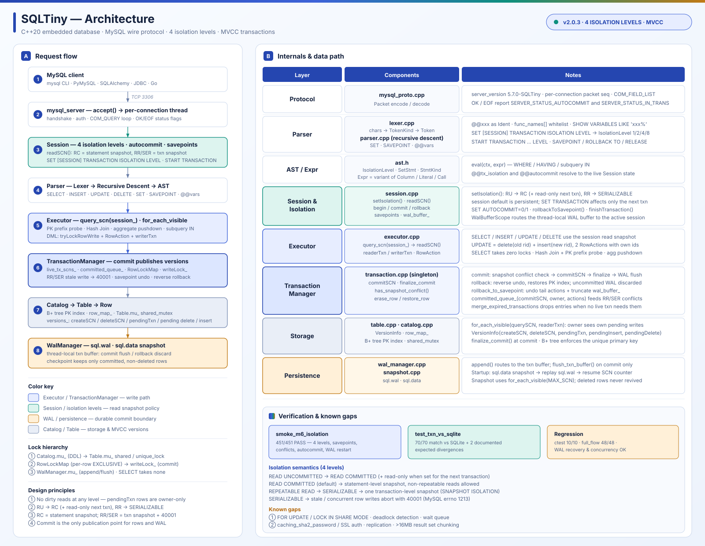

# SQLTiny — 轻量级嵌入式数据库 · MySQL 协议兼容

> 🌐 语言: [English](./README.en.md) · **简体中文**

> **当前版本 `v2.2.2`(2026-11-24)** · 版本号统一维护在 `CMakeLists.txt`(`project(SQLTiny VERSION 2.2.2)`)、`vcpkg.json`(`version-string`)与 `src/main.cpp` 启动横幅。协议层对外仍伪装为 `5.7.0-SQLTiny` 以兼容 MySQL 客户端,与产品版本无关。
>
> v2.2.2 交付 **benchmark TOP5 查询性能优化**(CASE 流式分组 / EXISTS 首行即停 / 融合 JOIN 裸列直取 / DISTINCT 提前去重 / PK 上界范围扫描),内容见下文「v2.2.2 更新内容」。

**SQLTiny** 是用现代 C++20 从零重写的轻量级关系型数据库,核心设计灵感来自 [HSQLDB](http://hsqldb.org/),额外暴露 **MySQL Wire Protocol**——标准 MySQL 客户端(`mysql` CLI、Navicat、DBeaver、Connector/J、PyMySQL、DBX/dbExpress)直接连接。

> 完整项目规划见 [`CODEPLAN.md`](./CODEPLAN.md),架构映射、技术选型、里程碑验收都在里面。

---

## ✨ 特点

| 特性 | 说明 |
|---|---|
| 🧠 **纯 C++20** | 无 Java / SQLite / RocksDB 依赖 |
| 🗄️ **嵌入式优先** | 进程内 C++ 调用 或 TCP 客户端连接,两种模式 |
| 🎯 **MySQL 协议兼容** | PyMySQL / mysql CLI / Navicat / SQLAlchemy / **dbExpress(DBX) 驱动** 直连,握手 + 类型推断 + NULL 编解码完整 |
| 🔧 **服务端预编译语句** | `COM_STMT_PREPARE / EXECUTE / CLOSE / RESET / SEND_LONG_DATA` 完整 binary protocol |
| 🗂️ **information_schema** | SCHEMATA / TABLES / COLUMNS 等虚拟表,第三方工具元数据浏览直接可用 |
| 🗃️ **多库 Catalog** | CREATE/DROP/USE DATABASE,库级独立表注册 |
| ⚡ **B+ 树内存索引** | 主键索引为自研 B+ 树(v2.0.0 起),点查 O(logₙ) · 叶子链顺序扫描 |
| 🪶 **轻量** | 单库文件,启动毫秒级,依赖仅 fmtlib;**静态编译**(`x64-windows-static`),产物不依赖 `fmt.dll` / VC 运行时 DLL |
| 🧪 **ASan 构建** | 可选 `windows-asan` preset(MSVC `/fsanitize=address`,无需 Clang/LLVM),用于越界/崩溃检测与模糊测试 |

---

## 🏛️ 系统架构



> 🎨 **配色语义**: 靛蓝 = 执行/事务写路径 · 青绿 = Session 与隔离级别(读快照策略) · 琥珀 = WAL 与持久化(提交边界) · 灰蓝 = Catalog/Table 存储与 MVCC 版本
>
> 🔒 **锁分层**: Catalog.mu_(DDL) → Table.mu_ shared_lock(SELECT 多读者并行) / unique_lock(DML 独占) → RowLockMap(行级冲突检测) → TransactionManager.writeLock_(提交边界) → WalManager.mu_(WAL 文件读写)
>
> 🧊 **MVCC**: SELECT 完全不加锁,`for_each_visible(querySCN, readerTxn)` 按 `createSCN/deleteSCN` 与 `pendingTxn` 过滤;未提交行只对所属事务可见,commit 才 `finalize_commit` 对外发布

---

## 🆕 v2.2.2 更新内容（benchmark TOP5 查询优化，2026-11-24）

按 `benchmark/employees_query_detail.csv` 的 `rank_by_delta` 前 5 项做定向优化，以 `tests/benchmark/compare_employees.py`（MySQL 3306 vs SQLTiny 3307，employees 300024 / salaries 2844047）做同条件对比：

| 查询（CSV rank） | v2.2.1 Release | v2.2.2 Release | 手段 |
|---|---:|---:|---|
| #1 CASE WHEN + GROUP BY 别名 + ORDER BY | 7.02s | **2.59s** | 流式聚合支持 CASE 分组键与输出列排序，避免 284 万行物化 |
| #2 EXISTS 相关子查询 COUNT | 4.11s | 4.12s | 首行即停 + 完整 WHERE 校验（防止误判），语义保持、耗时持平 |
| #3 三表 JOIN + HAVING + ROUND(AVG) | 4.26s | **3.63s** | 融合 JOIN 聚合裸列参数直读行内偏移，免去每行 `ExecContext` + `eval` |
| #4 DISTINCT + ORDER BY + LIMIT/OFFSET | 2.00s | **0.81s** | ORDER BY 仅引用输出列时先去重再排序（44 万行排序 → 7 行） |
| #5 ROW_NUMBER + `emp_no<=10010` | 1.62s | **0.02s** | 整数 PK 上界下推 B+Tree 范围扫描（复合主键开区间处理，不漏 `(hi,...)` 整组） |

复杂类总耗时 18.90s → 10.92s（-42%）。实现落在 `executor.cpp/h`、`expr.cpp`、`storage/table.cpp/h`（+215/-25 行）。

**验证**：`compare_employees.py` 两版均 **39/39 MATCH，fails=0**；sqllogictest 逻辑套件 **1184 / PASS 1132 / GAP 52 / FAIL 0**（与基线一致）；`smoke_m6_hsqldb_matrix.cpp` 新增 TOP5 语义回归 **105 PASS / 0 FAIL**；Python 套件 5 脚本全通过。

---

## 🆕 v2.2.1 更新内容（MSVC ASan 构建，2026-11-21）

不改变 SQL 语义与协议行为;新增可选的 **MSVC AddressSanitizer** 构建,并支撑外部逻辑测试套件中的 Hypothesis 有状态模糊测试。

- **`windows-asan` preset**:无需 Clang/LLVM,`SQLTINY_ASAN=ON` 为全部目标加 `/fsanitize=address /Zi`,产物在独立的 `build-asan/RelWithDebInfo/`
- **运行时 DLL 自动部署**:POST_BUILD 把 `clang_rt.asan_dynamic-x86_64.dll` 拷到每个 exe 旁,Python 脚本可直接 spawn 构建产物,无需修改 `PATH`
- **fmt 注解冲突规避**:预编译 `fmt.lib` 未开启 ASan,通过 `_DISABLE_VECTOR_ANNOTATION` / `_DISABLE_STRING_ANNOTATION` 消除 LNK2038;堆/栈越界检测不受影响
- **验证基线**(ASan server):SLT **1184 / PASS 1133 / GAP 51 / FAIL 0**,协议 **42/42**,持久化 **15/15**;同级 `SQLTinySLT` 的 Hypothesis 模糊测试 100+ examples / 约 6000 语句,**0 崩溃 / 0 协议失步 / 0 oracle 失败**

边界:UBSan 与 libFuzzer 覆盖率插桩是 Clang 专属,MSVC 下不可用;ASan 只做内存错误与崩溃检测。

---

## 🆕 v2.2.0 更新内容（命令行导入 / dump 导出，2026-11-17）

`sqltiny_server.exe` 新增批处理模式：不启动网络服务，直接对 `--data-dir` 中的数据库执行 SQL 脚本导入或导出，执行完退出。

**导入 `--import FILE`**
- 流式切分 SQL 脚本，支持 `--` / `#` 行注释、`/* ... */` 与 MySQL `/*! ... */` 条件注释、单/双/反引号及转义、`DELIMITER` 自定义分隔符
- 自动跳过 mysqldump 生成的 `LOCK TABLES` / `UNLOCK TABLES`；兼容列级 `COLLATE` / `CHARACTER SET` / `ON UPDATE` 与任意位置的表级 `AUTO_INCREMENT=n`
- 逐条自动提交；`--import-continue-on-error` 单条失败后继续，`--import-quiet` 静默进度，`--import-then-serve` 导入完成后继续启动服务

**导出 `--dump FILE`**
- 输出 `CREATE DATABASE IF NOT EXISTS` / `USE` / `DROP TABLE IF EXISTS` / `CREATE TABLE`（主键、默认值、AUTO_INCREMENT 游标）/ 多行 `INSERT`
- `--dump-database` / `--dump-table` 过滤库表，`--dump-no-create` / `--dump-no-data` / `--dump-no-drop` 裁剪内容，`--dump-batch-rows N` 控制每条 INSERT 行数
- `--dump -` 写 stdout，引擎与导入导出日志改走 stderr，可直接重定向为纯 SQL 文件

**验证**：新增 `smoke_cli_io` **40 checks / 0 FAIL**（注释、转义、`DELIMITER`、`LOCK TABLES` 跳过、dump→import 往返、默认值/自增游标）；手工验证 mysqldump 风格脚本导入、`--dump -` 重定向、`--import-then-serve` 服务启动。
---

## 🆕 v2.1.0 更新内容（benchmark TOP 查询优化，2026-11-16）

按 `benchmark/employees_query_detail.csv` 的 TOP 瓶颈排名，优化前 3 项 + 一项高基数 GROUP BY，均未引入 FAIL。

| 查询（优化前耗时） | 优化后 | 手段 |
|---|---|---|
| rank1 CTE `MAX(salary) GROUP BY emp_no`（10.3s） | **1.15s** | 单表 GROUP BY 流式聚合快路径 |
| rank2 `COUNT(*) WHERE salary > (SELECT AVG(salary))`（8.17s） | **0.77s** | 非相关标量子查询常量折叠，恢复 fast_agg |
| rank20 `COUNT(*) WHERE emp_no IN (SELECT ...)`（0.67s） | **0.43s** | IN 候选集 hash 索引 |

- **非相关标量子查询常量折叠**：扫描前把 WHERE 里 `列 op (SELECT ...非相关单值)` 求值为字面量，让 `add_pred` 识别并恢复单表 fast_agg（原因 rhs 是 Subquery 而禁用，284 万行走通用路径）
- **IN 候选集 hash 索引**：`SqEntry` 缓存单列结果时构建 `unordered_set`，`__in` 查找从 O(n) 线性扫描降到 O(1)，保留三值逻辑（NULL→UNKNOWN）
- **单表 GROUP BY 流式聚合**：单表/简单分组列/简单聚合/无 HAVING-ORDER-LIMIT 时，边扫描边按 key 累加，不再物化 284 万整行到 30 万桶；支持 COUNT(*)/COUNT(col)/SUM/AVG/MIN/MAX/多分组列/常量列
- 总体：`employees` 39 查询 SQLTiny 总耗时从 79s 降到 21.5s（基准对比见 `benchmark/history.csv` 三组演进）

**验证**：SLT **1184 / PASS 1132 / GAP 52 / FAIL 0**（无回归）；compare_employees **39/39 MATCH**；GROUP BY 10 类边界（NULL/多分组列/多聚合/WHERE）全 MATCH。

---

## 🆕 v2.0.9 更新内容（聚合下推增强，2026-11-16）

由 benchmark 一级/二级对比定位驱动：3 表 JOIN + `ROUND(AVG(...))` + `HAVING` 查询从 **18.7s 降到 ~5s**（约 4x），未引入 FAIL。

**聚合下推判据扩展**（`executor.cpp`）
- 支持**标量函数包裹聚合**（如 `ROUND(AVG(s.salary),2)`）：累加内层聚合值后套用外层函数（原判据因顶层非聚合而禁用下推）
- 支持 **HAVING**：判据允许 HAVING 存在，产出聚合结果后在 fused 路径直接过滤；HAVING 聚合按签名匹配到已累加值（别名、多聚合、COUNT、WHERE 混合、ROUND 包裹、直接 AVG 均验证通过）
- HAVING 引用的聚合若不在 SELECT 投影中则回退通用路径，保证语义正确
- 融合列 `fused_raw_aggs` 与各列索引对齐（修复 HAVING 聚合值取错列的 bug）
- 顺带修复 `Expression::clone()` 漏拷贝 `is_window`/窗口字段

**验证**：SLT **1184 / PASS 1132 / GAP 52 / FAIL 0**（无回归）；compare_employees **39/39 MATCH**，目标查询 18.7s→~5s。

---

## 🆕 v2.0.8 更新内容（P1-b DML 方言 + DDL 核心，2026-11-16）

由独立 sqllogictest 套件的 P1-b 批次驱动，GAP 从 **78 降到 52**，FAIL 保持 0。

**INSERT 方言**
- `INSERT ... VALUE`（单数）、`INSERT INTO t () VALUES ()`、`INSERT ... SET col=expr, ...`
- `INSERT IGNORE`（主键冲突跳过 + warnings）、`REPLACE INTO`（冲突删旧插新）、`ON DUPLICATE KEY UPDATE`（冲突更新指定列）

**UPDATE / DELETE 扩展**
- `UPDATE ... ORDER BY ... LIMIT`、`DELETE ... ORDER BY ... LIMIT`
- 多表 `UPDATE t a JOIN u b ON ... SET a.c = b.d`
- `TRUNCATE TABLE`（清空行、重建唯一索引、自增游标归零）

**AUTO_INCREMENT**
- 建表 `AUTO_INCREMENT=n` 起始值生效（cursor 初始化为 n-1）
- 非主键自增列（`seq INT AUTO_INCREMENT, KEY (seq)`）可建表并分配

**DDL 核心**
- `CREATE TABLE ... AS SELECT`（按查询结果推断列并填数据）、`CREATE TABLE ... LIKE src`（复制定义）
- `CREATE TEMPORARY TABLE`、`CREATE VIEW ... AS SELECT`、`CREATE [UNIQUE] INDEX`
- `ALTER TABLE ... ADD COLUMN`（追加列并给现有行补默认值）、`RENAME TABLE ... TO ...`
- 表级/列级 `KEY` / `UNIQUE` / `CHECK` 约束语法可解析
- **DDL 隐式提交**：事务中执行 DDL 前先 commit，之前的 DML 不被随后的 ROLLBACK 撤销

**验证**
- SLT 全量 **1184 项 · PASS 1132 / GAP 52 / FAIL 0**
- 协议 **42/42** · 持久化 **15/15**（CTest 2 项既有 smoke 偏差与本次改动无关，已用 HEAD 基线对比确认）

---

## 🆕 v2.0.7 更新内容（P1-a 日期时间函数模块，2026-11-16）

由独立 sqllogictest 套件的 P1-a 批次驱动,补齐 **14 个日期时间 GAP**,GAP 从 **92 降到 78**,仍未引入 FAIL。

**新增函数**

| 类别 | 函数 |
|---|---|
| 日期运算 | `DATEDIFF` · `DATE_ADD(d, INTERVAL n UNIT)` · `DATE_SUB` · `LAST_DAY` |
| 提取/格式化 | `DAYOFWEEK`(1=周日) · `WEEK` · `DATE_FORMAT`(`%Y/%m/%d/%H/%i/%s`) · `STR_TO_DATE` |
| 时间戳 | `UNIX_TIMESTAMP` · `FROM_UNIXTIME` |
| 当前时间 | `CURTIME` · 无括号 `CURRENT_DATE` / `CURRENT_TIMESTAMP` / `CURRENT_TIME` |

**实现要点**
- lexer 新增 `INTERVAL` token;parser 把 `INTERVAL n UNIT` 折为 `__interval(n, 'UNIT')` 参数,并把无括号的 `CURRENT_DATE` / `CURRENT_TIMESTAMP` / `CURRENT_TIME` 直接折成函数调用(否则会被当成列名求值 NULL)
- `expr.cpp` 统一日期解析入口,采用 civil-days 算法(含 1970 epoch 偏移)做日期加减/差值,支持 YEAR/MONTH/QUARTER/DAY/WEEK/HOUR/MINUTE/SECOND;月末按当月天数收敛
- `DATETIME - DATETIME` 返回秒差(`NOW() - NOW()` = 0)
- 顺带修正 P0 引入的 1055 回归:`SELECT dept_name … GROUP BY d.dept_name` 中裸名与限定名现在视为同一列

**验证**
- SLT 全量 **1184 项 · PASS 1106 / GAP 78 / FAIL 0**(日期文件 `03_datetime.slt` 45/45,14 条 `gap` 标记已移除)
- 协议 **42/42** · 持久化 **15/15** · `compare_employees.py` **39/39 MATCH**

---

## 🆕 v2.0.6 更新内容（MySQL 语义兼容修复，2026-11-16）

由独立 sqllogictest 测试集（与本仓库同级的 `SQLTinyTest/testcase`，36 个 `.slt`，按 MySQL 8.0 语义书写）驱动：首轮 **1184 项 / PASS 971 / GAP 146 / FAIL 67**，修复后 **PASS 1092 / GAP 92 / FAIL 0**；协议套件 **42/42**，持久化 **15/15**。

### 1. 值语义与表达式

| 类别 | 修复 |
|---|---|
| NULL 排序 | `Value::compare` 视 NULL 为最小值：ASC 最前 / DESC 最后 |
| 三值逻辑 | `NULL IN (...)`、`NOT IN (…,NULL)` 返回 UNKNOWN；`AND/OR/NOT` 完整三值 |
| LIKE | 默认不区分大小写（`regex::icase`），`'Alice' LIKE 'a%'` = 1 |
| 隐式转换 | 算术表达式按数值处理，`SELECT '5' + 3` → `8`；列与字符串字面量的等值比较仍走字符串语义（`sal = '9000'` 为已知 GAP） |
| NULL 传播 | `LENGTH/CHAR_LENGTH(NULL)` → NULL；`NULLIF` / `IFNULL` / `COALESCE` 正确求值（`IF()` 与关键字冲突，暂为 GAP） |
| ROUND | DECIMAL 字面量按定点舍入，`ROUND(1.005,2)` = `1.01` |
| 未知函数 | 报 `1305 FUNCTION ... does not exist`，不再静默返回 NULL |
| 函数补齐 | `UPPER/LOWER/TRIM/LTRIM/RTRIM/SUBSTR/REPLACE/REVERSE/LPAD/RPAD/REPEAT/CONCAT_WS/ASCII/CHAR`、`CEIL/FLOOR/MOD/POWER/SQRT/SIGN/GREATEST/LEAST`、`LOCATE` 三参数 |

### 2. 协议层

- BIGINT 极值按整数文本下发（`-9223372036854775808`），整型列的整数值不再输出科学计数法
- 表达式结果列推断为数值类型（`SELECT 1` 的列类型为 LONGLONG，而非 VAR_STRING）
- `COM_STMT_EXECUTE` 字符串参数绑定整数列时按列类型隐式转换后命中
- `COM_STMT_PREPARE` 语法错误返回 1064

### 3. SQL 校验与报错（对齐 MySQL）

`1048` NOT NULL · `1054` 未知列（SELECT / INSERT）· `1136` 插入列数不匹配 · `1366/1264/1406` 类型 / 范围 / 长度 · `1064` 缺投影列表 · `1242/1241` 标量 / IN 子查询 · `1248` 派生表缺别名 · `1049` 已删库 · `1111` 嵌套聚合 · `1055` ONLY_FULL_GROUP_BY · `1222` UNION 列数 · `3593` 窗口函数出现在 WHERE · `1305` 未知函数

### 4. 查询能力

- `RIGHT JOIN`、逗号连接（隐式 CROSS JOIN）、链式 JOIN 复用同一表名/别名
- 空输入 + `GROUP BY` 不再产出伪行；`GROUP BY` 后的 `LIMIT/OFFSET` 生效
- 窗口函数：`ROW_NUMBER() OVER` 与 `COUNT/SUM/AVG/MIN/MAX ... OVER (PARTITION BY … ORDER BY …)` 逐行返回；`RANK()` 结果与 MySQL 一致（用例期望值待校正），`DENSE_RANK/LAG/LEAD/COUNT(*) OVER/命名窗口` 仍为 GAP
- `UNION` 列数校验、左右类型统一；`LIMIT/OFFSET` 越界返回空集

### 5. 元数据

- `information_schema.STATISTICS` / `KEY_COLUMN_USAGE` 输出主键索引与主键列约束
- `SHOW COLUMNS` 的 `Default` 列返回真实默认值
- `SELECT @@autocommit` 返回 `1`；`lower_case_table_names` 统一为 `1`
- 隔离级别按请求原样返回（不再把 `REPEATABLE READ` 映射成 SERIALIZABLE）

### 6. 测试结果

| 套件 | 结果 |
|---|---|
| sqllogictest（36 文件） | 1184 项 · **PASS 1092 · GAP 92 · FAIL 0** |
| `test_protocol.py` | **42 / 42 PASS** |
| `test_persistence.py` | **15 PASS / 0 GAP / 0 FAIL**（优雅关闭 → checkpoint → 截断 WAL 已补齐） |

---

## 🆕 v2.0.5 更新内容

`tests/benchmark/compare_employees.py` 从 14 条扩到 **39 条**(基础 14 / 嵌套子查询 10 / WITH·CTE 4 / 复杂查询 11),以 MySQL 3306 同库双端对照,暴露出 3 类问题并全部修复。

### 1. 静默正确性缺陷(不报错、结果错)

| 缺陷 | 现象 | 修复 |
|---|---|---|
| GROUP BY 别名失效 | `GROUP BY g`(别名)按未知列求值 NULL,全表塌成一组 | 分组键回查 SELECT 表达式 |
| 函数内嵌聚合 | `ROUND(AVG(salary),2)` 返回 `0` | 聚合上下文内递归求值 |
| 日期函数缺失 | `YEAR(hire_date)` 静默 NULL,按年分组全落一组 | 补齐 YEAR/MONTH/DAY 等 |

### 2. 语法补全

WITH / CTE(含多 CTE)、`WITH RECURSIVE` 递归 CTE、标量子查询(WHERE 比较与 SELECT 列,含相关)、`EXISTS`、FROM 派生表、`COUNT(DISTINCT)`、`BETWEEN`、**窗口函数 `ROW_NUMBER() OVER (PARTITION BY … ORDER BY …)`**。

### 3. 性能修复

| 问题 | 修复前 | 修复后 |
|---|---|---|
| 高基数 GROUP BY 分桶线性查找 O(组数²) | salaries 30 万组 **超时 100s** | **3.80s**(改 `unordered_map`) |
| 相关 `IN` 子查询逐行全扫内表 | **超时 100s** | **0.096s**(外层列等值走 PK 前缀探测) |
| 递归 CTE 用累积全集迭代(UNION ALL 指数膨胀) | **超时 100s** | **0.001s**(改上一轮增量工作集) |
| 相关子查询结果被误缓存 | 只返回第一行(2 条 MISMATCH) | 去相关求值时置 `outer_used` |

### 4. 最终结果(39 条,MySQL vs SQLTiny)

| 类别 | 条数 | 结果 | MySQL | SQLTiny |
|---|---|---|---|---|
| 基础 | 14 | 14 MATCH | 14.00s | **5.45s** |
| 嵌套 | 10 | 10 MATCH | 3.26s | 5.84s |
| WITH | 4 | 4 MATCH | 1.42s | 4.13s |
| 复杂 | 11 | 11 MATCH | 9.82s | 12.73s |

`SUMMARY: fails = 0`。对比脚本同时改为**每条查询独立连接 + 100s 超时**,避免某条超时后连接失效、后续查询连锁误报 `(0,'')`——首轮的 11 条 ST-ERR 大部分是这种假象。

### 5. 测试

- 新增 `smoke_sql_keywords`(**649 PASS**,180 个关键词 + 词法/Parser 基础)、`smoke_sql_syntax`(**160 PASS / 15 GAP**,常用语法端到端矩阵),CTest 增至 **12 个目标**
- `smoke_m25_e2e` 端口统一为 **3307**,不再因 3306 是需密码的 MySQL 而 auth 失败
- CTest **12/12** 全通过

---

## 🆕 v2.0.4 更新内容

本版本包含两类改进:**单表聚合的单遍扫描快路径**,以及 **UNION / UNION ALL 支持**。

### 1. 融合聚合快路径(单遍扫描)

此前 `SUM(salary)` 走通用聚合路径:280 万行要做 `left_rows` / `candidate_rows` / `buckets` 三次全表行拷贝,扫描阶段逐行 `build_ctx` + `eval(列)`,聚合阶段再来一遍,耗时 **2.97s**。`WHERE salary>100000` 同理:谓词逐行 `eval` 后再物化 9.4 万行,耗时 **0.774s**。

新路径在扫描前解析列偏移和谓词操作数,在 `for_each_visible` 回调里直接过滤 + 累加,不物化任何中间行。触发条件保守:单表、无 JOIN/GROUP BY/HAVING/DISTINCT/ORDER BY/LIMIT,投影列全是简单聚合(`COUNT(*)` / `COUNT|SUM|AVG|MIN|MAX(列)`),WHERE 可拆成 AND 连接的「列 op 字面量」比较;存在可走索引探测的 PK 等值时仍让位给索引探测。整数比较在 2^53 无损范围内直比 `int64`,避免每次 `try_to_double`。

| 查询(employees 392 万行,Release,5 次均值) | v2.0.3 | v2.0.4 | MySQL 3306 |
|---|---|---|---|
| `SELECT SUM(salary) FROM salaries` | 2.969s | **0.352s** (~8.4x) | 0.33s |
| `SELECT COUNT(*) FROM salaries WHERE salary>100000` | 0.774s | **0.248s** (~3.1x) | 0.28s |
| `COUNT + SUM + AVG + MIN + MAX` 五合一 | — | 0.422s | — |
| `SUM(salary) WHERE emp_no=10001`(PK 探测) | 0.000s | 0.000s(路径未变) | — |

NULL 空集(`SUM/AVG/MIN/MAX → NULL`、`COUNT → 0`)、字符串 MIN/MAX、合格列名、字面量在左(`100000<salary`)、多 AND 谓词均已与 MySQL 对比一致;跨类型字符串字面量(`salary>'100000'`)维持既有行为。

### 2. UNION / UNION ALL

AST 早有 `set_op` / `set_right` 字段,但 parser/executor 一直未接入。本版本补齐:

- `parser.cpp`:解析 `UNION [ALL | DISTINCT] SELECT ...`,右分支递归,支持链式 UNION
- `executor.cpp/.h`:`exec_select` 拆为 UNION 包装层 + `exec_select_body`;UNION ALL 直接拼接,UNION 去重;右分支末尾的 ORDER BY/LIMIT 作用于整个 UNION 结果;列数不齐按 NULL 补齐
- 顺带支持 `ORDER BY 1` 数字位置序号(MySQL 常用写法,此前缺失)

三端对比(employees 数据集,3 次均值):

| 查询 | MySQL 3306 | tcdb 3308 | SQLTiny 3307 |
|---|---|---|---|
| `COUNT(employees) ∪ ALL COUNT(salaries)` | 0.03s | 0.00s* | 0.26s |
| `salaries>100000 ∪ ALL salaries<=100000` | 0.38s | 0.00s* | 0.58s |
| 2 万行员工结果集 UNION ALL | 0.02s | 0.02s | 0.26s |
| GROUP BY 结果 UNION ALL | 0.10s | 0.00s* | 0.64s |
| UNION 去重 / 链式 / ORDER BY+LIMIT | — | 16384 行上限报错 | 与 MySQL 一致 |

\* tcdb 的纯 `COUNT(*)` 查询疑似命中结果缓存,不宜当作真实扫描速度。SQLTiny 各分支顺序执行,简单聚合分支走新快路径;GROUP BY 分支仍走通用路径,是主要差距来源。

### 回归

`ctest` 9/10(`smoke_m25_e2e` 硬编码连 3306,当前 3306 是需密码的 MySQL,环境性 auth 失败);`test_full_flow` 48/48、`test_vs_sqlite` 全场景一致、`test_stmt_prepare` 7/7 均指向 3307 通过。

---

## 🆕 v2.0.3 更新内容

主键点查此前与普通查询同路:全表扫描 30 万 / 280 万行并逐行 `eval` 谓词,`SELECT COUNT(*) FROM employees WHERE emp_no=10001` 要 **74 ms**。本版本让「主表主键首列等值」直接走**主键前缀索引探测**,不再扫整表。

### 两处改动

1. **执行器:`WHERE pk = 常量` → 索引前缀探测**(`src/executor/executor.cpp`)。`WHERE` 按 `AND` 拆成连接词后找「主表 PK 首列 = 字面量」等值条件,命中则用 `for_each_by_pk_prefix` 只访问键匹配的行;谓词仍在回调里逐行复核,与全表扫描语义一致。为防跨类型漏行,只接受**同类型家族**字面量(整型列配整型字面量、字符串列配字符串字面量等),跨类型仍走全表扫描;`IS NULL` / 参数占位符不参与探测。
2. **存储层:逻辑删除回退保护**(`src/storage/table.{h,cpp}`)。MVCC 逻辑删除会**立即**把键从主键索引摘掉、却保留 `row_map_` 里的物理行,此时「索引扫描」不再是「全表扫描」的超集(旧快照 / 未提交删除的行会漏)。因此新增 `dead_rows_` 计数器与 `has_dead_rows()`(首次置删自增、物理清除 / 回滚恢复自减),存在逻辑删除历史时点查**自动回退全表扫描**,四个隔离级别下的可见性语义不变。

### 实测(employees 392 万行,Release,5 次均值)

| 查询 | v2.0.2 | v2.0.3 | 提升 |
|---|---|---|---|
| `SELECT COUNT(*) FROM employees WHERE emp_no=10001` | 74 ms | **0.13 ms** | ~570x |
| `SELECT COUNT(*) FROM salaries WHERE emp_no=10001` | 678 ms | **0.17 ms** | ~4000x |
| `WHERE emp_no>499000`(范围,非等值) | 92 ms | 92 ms | 不变(仍全表扫描) |
| `WHERE first_name='Georgi'`(无索引列) | 87 ms | 87 ms | 不变(仍全表扫描) |

**适用范围**:索引探测只对「主键首列等值」生效,范围 / `LIKE` / 非主键列 / 复合主键非首列一概不受影响。

### 边界验证

- 不存在的主键 → `0`;`salaries` 单员工 → `17` 行;`emp_no>499000` → `999`;`first_name='Georgi'` → `253`,逐条与 MySQL 一致。
- 删除提交后点查该行 → `0`;`DELETE` + `ROLLBACK` 后该行重新可见(`dead_rows_` 回退路径生效),表总行数不变。
- `architecture.svg` 同步更新:移除 HSQLDB 字样、PK 索引标注 AVL → B+ 树、执行器标注 PK 前缀探测 / Hash Join / 聚合下推,版本徽标改为 `v2.0.3`。

---

## 🆕 v2.0.2 更新内容

在 v2.0.1 基础上扩大**聚合下推覆盖面**,把此前仍走「物化中间行」的两类查询也纳入下推,employees 数据集 5 项 JOIN 基准全部进入下推快路径。

### 两项扩展

1. **WHERE 按表侧拆分**:`WHERE` 按 `AND` 拆成连接词后分类——只引用左表列的在扫描阶段预过滤,只引用右表列的在探测回调里过滤,跨表引用则整体回退。此前只要 `WHERE` 出现右表列就放弃下推,`高薪员工数` 这类混合谓词因此仍物化 280 万行。
2. **哈希等值 JOIN 也下推**:下推判据由「仅 PK 前缀探测」放宽为「PK 前缀探测 **或** 哈希等值探测」;哈希路径在融合分支内本地物化右表建桶,探测时直接累加,不再物化 `left × matches` 拼装行。

同时加固:表达式中出现**子查询 / CASE / 占位符 / 星号**时一律不下推(引用面无法静态判定)。

### 实测(employees 392 万行,Release)

| 查询 | v2.0.1 | v2.0.2 | MySQL | 剩余差距 |
|---|---|---|---|---|
| 3 表 JOIN 求各部门均薪 | 2.06 s | **2.05 s** | 1.60 s | 1.28x |
| `employees⋈salaries WHERE emp_no=10001` | 0.105 s | **0.081 s** | <0.01 s | — |
| 单员工行数 | 0.094 s | **0.086 s** | <0.01 s | — |
| 高薪员工数(下推+混合谓词) | 2.76 s | **0.94 s** | 0.37 s | 2.5x |
| 2 表 JOIN 计行(哈希路径) | 0.37 s | **0.13 s** | 0.05 s | 2.5x |

自 v2.0.0 累计:3 表 JOIN **18.42 s → 2.05 s(9x)**、高薪员工数 **6.90 s → 0.94 s(7.3x)**、2 表哈希计行 **0.93 s → 0.13 s(7.2x)**。

### 回归

`ctest` **10/10**;`smoke_m6_hsqldb_matrix` 73/73;`test_full_flow` **48/48**;`test_vs_sqlite` 全场景一致;`test_stmt_prepare` 7/7;`compare_employees` **14/14 MATCH**;逐行数值与 MySQL 一致(仅既有的 AVG 小数位 / SUM 类型表现差异)。

---

## 🆕 v2.0.1 更新内容

本版本聚焦 **3 表 JOIN 执行性能**。在 v2.0.0(B+ 树)基线上对 employees 标准数据集(392 万行)实测:3 表 JOIN 求各部门均薪 **18.25s**,而 MySQL 仅 **1.57s**。定位到三处执行器开销并逐一修复,最终 **18.25s → 1.97s(9.3x)**,与 MySQL 差距从 **11.7x 缩到 1.25x**。

### 端到端(employees 392 万行,Release 构建)

| 查询 | v2.0.0 | v2.0.1 | MySQL |
|---|---|---|---|
| **3 表 JOIN + GROUP BY + AVG** | 18.25 s | **1.97 s** | 1.57 s |
| 3 表 JOIN + `COUNT(*)` | 6.44 s | **1.60 s** | — |
| 3 表 + `SUM/AVG/MIN/MAX/COUNT` 五聚合 | — | 3.28 s | — |
| `employees⋈salaries WHERE emp_no=10001` | 2.10 s | **0.08 s** | — |

### 根因与修复

1. **`ExecContext` 每行深拷贝**(占比最大):`build_ctx` 每行都拷贝整行 + 深拷贝 `col_index`(约 40 节点 map);GROUP BY 分桶 + 聚合两遍约 **1100 万次**调用,产生数亿次分配。改为 `row_ref` / `idx_ref` 指针,**`eval` 优先零拷贝取行与列索引**,`build_ctx` 变成 O(1)。**18.25 s → 7.24 s**
2. **`idx_probe` 仍在物化右表**:注释称"右表零物化",代码却无条件 `for_each_visible` 拷贝右表全部行并逐行 `to_string` 建哈希桶——salaries 的 280 万行被白做一遍。改为仅非 `idx_probe` 路径物化。**7.24 s → 6.27 s**,点查 **2.10 s → 0.08 s**
3. **中间行物化**(结构性修复):JOIN 为 314 万匹配行各构造 10 列整行(每行含 6 次字符串堆分配)。新增**聚合下推到 PK 前缀探测 JOIN**:当分组键与 WHERE 只引用左表列、聚合参数只引用右表列时,边探测边累加,不再物化中间行,每个分组仅保留 1 条代表性整行(供 ORDER BY 与非聚合列)。**6.27 s → 1.97 s**

### 附带修正

- 聚合下推严格限定 `INNER JOIN`(LEFT JOIN 无匹配需补 NULL 行);由 `smoke_m6_hsqldb_matrix` 的「无匹配时 LEFT JOIN 保留左表」用例发现
- 聚合结果 `ORDER BY` 原实现对任意两行都用桶首行求值(恒等,等于不排序);下推路径改用各分组代表性行求值,`ORDER BY d.dept_name` 现按字母序正确输出

### 回归

`ctest` **10/10**;`smoke_m6_hsqldb_matrix` **73/73**;`test_full_flow` **48/48**;`test_vs_sqlite` 全场景一致;`test_stmt_prepare` 7/7;`compare_employees` **14/14 MATCH**(其中 3 表 JOIN:SQLTiny 1.87s vs MySQL 1.62s)。

---

## 🆕 v2.0.0 更新内容

本版本为**存储引擎索引结构升级**:主键索引从自研 AVL 树整体替换为 **B+ 树**(`IndexBPlusTree`),所有内部节点只存路由分隔键、全部条目落在叶子、叶子单向链表相连。

### 索引级收益(微基准 `bench_index`,Release,200 万条 salaries 主键)

| 操作 | AVL(v1.2.5) | B+ 树(v2.0.0) | 变化 |
|---|---|---|---|
| 随机点查 ×20 万 | 351.6 ms | **285.4 ms** | **+19%** |
| 复合键前缀扫描 ×20 万(JOIN 探测路径) | 449.7 ms | **340.4 ms** | **+24%** |
| 全量遍历 | 67.9 ms | **8.9 ms** | **7.6x** |
| 乱序插入 200 万 | 3787.8 ms | 3704.3 ms | 持平 |
| 树高 | 22 层 | 4 层 | 扇出 64 |

### 端到端(employees 数据集,Release 构建,`tests/debug/_bench_join.py`)

| 查询 | AVL | B+ 树 | 变化 |
|---|---|---|---|
| 3 表 JOIN 求各部门均薪 | 18.99 s | **18.42 s** | +3.0% |
| `employees⋈salaries WHERE emp_no=10001` | 2.17 s | **2.10 s** | +3.2% |
| 单员工行数 | 2.09 s | **2.00 s** | +4.3% |
| 高薪员工数(下推+混合谓词) | 7.20 s | **6.90 s** | +4.2% |
| 2 表 JOIN 计行(哈希路径) | 0.97 s | **0.93 s** | +4.1% |

> 说明:v1.2.5 文档中的 23.8s 为 Debug 构建数字;**自 v2.0.0 起性能基线统一使用 Release 构建**(同条件 Release 下 AVL 为 18.99s)。端到端提升约 3~4%——JOIN 耗时大头在执行器逐行求值/MVCC 过滤,与索引结构无关;索引级收益(扫描 +24%、遍历 7.6x)将在扫描密集型负载中进一步放大。WAL 回放(548MB)两者持平(~10s)。

### 做了什么

- **`IndexBPlusTree`**(`storage/index_bptree.h/.cpp`):内部节点最多 64 子/叶子最多 128 条,分裂自底向上迭代上推分隔键;叶子链支撑 `range_scan`/`prefix_scan`/`for_each` 顺序推进,命中即止;键全局有序,前缀扫描越过前缀即剪枝
- **惰性删除**:只从叶子移除条目,不收缩树高、不回收空叶——分隔键允许"偏高"(指向已删键),路由/扫描语义不变;以最小复杂度保证 MVCC 逻辑删场景下的正确性
- **`Key` 迁至 `storage/index_key.h`**:AVL 与 B+ 树共用键类型;`IndexAvl` 保留用于对照测试
- **`tests/bench_index`**:AVL/B+ 树 A/B 微基准(顺序/乱序插入、点查、前缀扫描、全量遍历),不进 ctest
- **`smoke_m1` 新增 B+ 树测试块**:乱序插入/点查/重复拒绝/删除/范围扫描/复合键前缀扫描(cb 提前停)/非唯一等键 find_all 与按 row_id 删除/全量扫描有序性/不变量校验

### 回归

`ctest` **10/10**;`test_full_flow.py` **48/48**;`test_vs_sqlite.py` 全场景一致;`test_stmt_prepare.py` 7/7;`compare_employees.py` **14/14 MATCH**。

---

## 🆕 v1.2.5 更新内容

本版本聚焦 **大表 JOIN 主键索引利用**(CODEPLAN §M6 P2 续):employees 标准数据集(392 万行)实测发现 3 表 JOIN 77s(MySQL 6.5s),右表 join 列为复合主键首列时仍走 Hash Join 全量物化。本版本改为 **PK 前缀索引探测**,右表零物化。

### 性能报告(2026-11-14,employees 数据集 300024×331603×2844047 行)

| 查询 | 优化前 | 优化后 | 提升 |
|---|---|---|---|
| 3 表 JOIN 求各部门均薪 | 77 s | **23.8 s** | 约 **3.2x** |
| `employees⋈salaries WHERE emp_no=10001` | 28 s | **2.3 s** | 约 **12x** |
| 混合谓词(下推+索引探测) | — | 9.8 s | 新路径 |
| 2 表 JOIN 计行(哈希路径回归) | — | 1.15 s | 无退化 |

`EXPLAIN` 正确显示 `salaries | ref | emp_no | Using index probe`(Extra 兼容保留 "hash join" 字样供既有断言)。

### 做了什么

- **AVL PK 前缀扫描**:`index_avl` 新增 `prefix_scan(key, cb)` —— 节点 key 截断到前缀长度逐列比较决定剪枝方向,命中键长 ≥ 前缀长即回调,复杂度 **O(log n + 命中数)**
- **表层前缀遍历**:`Table::for_each_by_pk_prefix(first_pk_value, querySCN, cb, readerTxn)` —— 前缀扫描 + MVCC `row_visible` 过滤(NULL 首列不命中)
- **执行器索引探测路径**:`extract_equi` 识别「join 列 = 右表复合 PK 首列」且左行数 ≤ 右行数时,逐左行构造 PK 首列 key 前缀探测右表,纯等值直接拼 flat row、复合 ON 再 `eval` 兜底,语义与 Hash Join 完全一致
- **WHERE 谓词下推**:`AND` 连接词拆分,只引用主表列且无歧义的 conjunct 在主表扫描阶段预过滤(限定名精确命中 / 裸名查 `ambiguous_cols`,Subquery/Case/Star 保守不下推)
- **SUM(DECIMAL) 列类型一致性修复**:`infer_type` 此前对 `SUM(DECIMAL)` 声明 LONGLONG,但聚合值经 double 路径返回 `'300.5'`,PyMySQL 按 LONGLONG 调 `int()` 崩溃并中断行读取,造成连接包序错位(`Packet sequence number wrong`)。现声明 DOUBLE 与实际返回值一致
- **协议排查工具**:`tests/debug/_repro_pkt.py`(裸 socket 逐包 dump,验证 server 帧连续性)、`tests/debug/_trace_seq.py`(PyMySQL 包序插桩)、`tests/debug/_bench_join.py`(employees JOIN 基准)

### 回归

`ctest` **10/10**(smoke_m25_e2e 连 server 全过);`test_full_flow.py` **48/48**;`test_vs_sqlite.py` 全场景一致;`test_stmt_prepare.py` 7/7;`compare_employees.py` **14/14 MATCH**;smoke_m3 聚合断言改为类型无关 `num_eq`。

---

## 🆕 v1.2.2 更新内容

本版本聚焦 **Navicat 实测兼容修复** —— Navicat 连接时报 `2013 - Lost connection to server during query`,根因是握手包错位解析。

### 修了什么

- **握手包 reserved 字段少写 1 字节**(致命修复):MySQL 协议 Handshake v10 在 `auth-plugin-data-length` 之后要求**恰好 10 字节**保留区,旧实现只写了 9 字节,导致后面所有字段整体前移 1 字节 —— Navicat 按规范解析时 auth-plugin 名变成错乱字节,识别不出插件后回退发送 `dummy_fallback_auth`,并在认证 OK 后直接断开(表现即 2013)。现改为循环写满 10 字节
- **`auth-plugin-data-length` 按规范修正为 21**(part1 8 字节 + part2 12 字节 salt + 1 字节 NUL),此前写的是 `min(21, len-8)=12`,与 MySQL 官方服务器广播值不一致
- **新增 `information_schema.ENGINES` 虚拟表**:Navicat 建连后固定探测 `SELECT COUNT(*) FROM information_schema.ENGINES WHERE Engine='ndbcluster'`,旧版回 ERR 1146 导致连接打开失败。现以 InnoDB 兼容身份上报单行(事务/XA/保存点 = YES)
- **`--query-log` 调试增强**:每次连接记录握手 + 认证 + 每条命令的**原始字节 hex dump**(含 seq),收发包失败点(EOF/reset)也会标记,客户端兼容性问题可一跑定位;`stdout/stderr` 改为无缓冲,重定向到文件时不再丢启动日志

### 回归

Navicat 建连实测通过(连接测试 + 打开连接 + 元数据加载);PyMySQL / SQLAlchemy 端到端全绿;握手包经脚本按协议逐字段解析校验(version / caps / charset / status / auth-data / plugin 全部对齐)。

---

## 🆕 v1.2.0 更新内容

本版本聚焦 **JOIN 性能优化**(CODEPLAN §M6 P2):从纯嵌套循环 O(N×M) 升级为 Hash Join,并补齐 `EXPLAIN` 与查询成本估算。

### 性能报告(2026-11-12,Release 版,PyMySQL 单进程,200 users × 800 orders)

| 查询 | 优化前 | 优化后 | 提升 |
|---|---|---|---|
| `INNER JOIN` | 298.40 ms | **3.91 ms** | 约 **77x** |
| `LEFT JOIN` | 297.20 ms | **4.77 ms** | 约 **62x** |
| 单进程整体 wall | 1822 ms | **73 ms** | 约 **25x** |

**线性扩展**:500 users × 2000 orders 大表 `INNER JOIN` 仅 **9.05 ms**(不再 100 万行 explode)。

### 做了什么

- **Hash Join**:从 `ON` 表达式递归提取「左表列 = 右表列」等值项(支持 `AND` 复合条件),右表按 key 分桶、左表 O(1) probe,复杂度 **O(N×M) → O(N+M)**;数值 key 统一提升 double、NULL 不参与等值;纯等值只做 `sql_equals` 复核,复合 `ON` 仍完整 `eval` 兜底保证语义完全一致
- **预建列索引**:列名→偏移映射只构建一次,消除旧实现里每个行组合都重建 map 的高额常数开销
- **`EXPLAIN` 最小版**:`EXPLAIN SELECT …` 只生成执行计划、不扫描数据,输出 MySQL 风格 8 列(`id / select_type / table / type / possible_keys / key / rows / Extra`);右表 join 列是单列主键时 `type=eq_ref`、`key=PRIMARY`,非等值 `ON` 显示 `Using nested loop (cost …)`
- **成本估算**:按表 `row_count()` 估算 `nested loop = left×right` / `hash = left+right`,多表 JOIN 逐轮传递基数,写入 `EXPLAIN` 的 `rows` 与 `Extra`

完整实现与回归说明见 `CODEPLAIN.md` §M6 P2。测评结果保存在 `benchmark/`：`employees_latest.json`（`tests/benchmark/compare_employees.py` 生成的 MySQL vs SQLTiny 39 条准确性/耗时明细）与 `perf_sqlite_latest.json`（`tests/benchmark/test_perf_vs_sqlite.py` 生成的 SQLite 性能对比），两类产物按前缀区分、互不覆盖。`employees_latest.json` 的 `comparison` 节点提供**一级（类别）**与**二级（单条查询）**对比详情——含耗时倍数、绝对差距、贡献占比、SQL 模式标签与优化优先级，并附 TOP 10 瓶颈清单（`employees_query_detail.csv` 为表格版），供下一轮性能优化定位。

### 回归

`smoke_m6_hsqldb_matrix` C 组新增 11 项断言(等值 / 反向等值 / 复合 ON / 非等值退化 / CROSS / LEFT 补 NULL / NULL key / 多表连续 Hash Join / EXPLAIN type 与 cost),现为 **73 PASS / 0 GAP**;`ctest` 10/10,Python 端到端全绿。

---

## 🆕 v1.1.2 更新内容

本版本聚焦 **GUI 客户端实测兼容修复**(以 DBeaver 26.2.4 / Connector/J 8.2.0 与 VS Code Database Client 实测驱动):

| 类别 | 内容 |
|---|---|
| **DDL 选项** | `CREATE DATABASE/SCHEMA/TABLE` 尾部的 `DEFAULT CHARACTER SET / COLLATE / ENGINE / AUTO_INCREMENT / COMMENT` 等选项被正确跳过,不再被当成下一条语句(修复 DBeaver 建库建表 1064 `unexpected start of statement: 'DEFAULT'`) |
| **SHOW TABLES 过滤** | `SHOW [FULL] TABLES [FROM db] [LIKE 'pat' \| WHERE col='pat']` 完整解析,表名过滤大小写不敏感(修复 DBeaver 建表校验 1064 `'WHERE'`) |
| **information_schema** | 新增 `REFERENTIAL_CONSTRAINTS` 虚拟表(空结果集),DBeaver 打开表时的外键查询不再报 1146 |
| **系统变量** | `SHOW VARIABLES` 补齐 `lower_case_table_names` / `max_allowed_packet` / `net_read_timeout` / `net_write_timeout` |
| **别名语法** | 双引号串(`AS "alias"` / 无 AS 裸 `"alias"`)与裸非保留关键字(`COLUMN_COMMENT comment`)可作列/表别名——Database Client 元数据查询的 1064 |
| **新函数** | `INSTR(str,sub)` / `LOCATE(sub,str)` / `POSITION`(大小写不敏感,1 起,未找到 0) |
| **回归** | `tests/smoke_m4.cpp` 扩展上述场景断言;`ctest` 10/10 |

---

## 🆕 v1.1.0 更新内容

本版本聚焦**第三方客户端兼容性**(以 Delphi dbExpress/DBX 驱动和类 Navicat 工具实测驱动):

| 类别 | 内容 |
|---|---|
| **服务端预编译语句** | 完整实现 `COM_STMT_PREPARE`(0x16) / `COM_STMT_EXECUTE`(0x17) / `COM_STMT_CLOSE` / `COM_STMT_RESET` / `COM_STMT_SEND_LONG_DATA`。参数按 binary protocol 解码(全类型 + NULL 位图)拼回 SQL 重放执行;SELECT/SHOW 在 prepare 阶段用 NULL 替换占位符探测列元数据(只读、安全);SELECT 结果以 binary resultset 返回 |
| **EOF 帧兼容** | 服务端不再广播 `CLIENT_DEPRECATE_EOF`,永远使用经典 EOF 帧帧定结果集——修复 DBX 等老客户端回显能力位后挂起 5 秒的问题 |
| **information_schema 虚拟表** | `SCHEMATA` / `TABLES` / `COLUMNS`(含 LEFT JOIN KEY_COLUMN_USAGE 这类工具元数据查询) / `TABLE_CONSTRAINTS` / `STATISTICS` / `TRIGGERS` / `ROUTINES` / `VIEWS` / `EVENTS`——每次查询物化,工具浏览元数据直接可用 |
| **SHOW 扩展** | `SHOW ENGINES` / `PLUGINS` / `CHARSET` / `CHARACTER SET` / `COLLATION` / `TABLE STATUS [LIKE]` / `INDEX|KEYS FROM db.tbl` / `FULL COLUMNS FROM db.tbl` / `PROCESSLIST` / `WARNINGS` / `TRIGGERS [WHERE]`;反引号 `db`.`tbl` 限定名解析 |
| **表达式** | `CASE [base] WHEN .. THEN .. [ELSE ..] END`(简单/搜索两种形式);`AUTO_INCREMENT` 等关键字可用作列名 |
| **协议命令** | `COM_FIELD_LIST`(db 限定 + `\0` 截断) / `COM_STATISTICS` / `COM_PROCESS_INFO` / `COM_CHANGE_USER`;SSL 请求返回明确 ERR |
| **系统变量** | `@@max_allowed_packet` / `@@net_write_timeout` / `@@net_read_timeout` / `@@sql_mode` / `@@lower_case_table_names` / `@@sql_auto_is_null` |
| **调试工具** | 新增 `--query-log FILE` 参数(逐条记录命令 + 握手 + 执行结果);`tests/dbx_probe.cpp`(58 断言,进程内逐条跑 DBX 典型 SQL) 与 `tests/functional/test_stmt_prepare.py`(7 断言,裸 socket 预编译协议) 回归 |
| **回归适配** | `tests/smoke_m25_e2e.cpp` 改为兼容经典 EOF 帧(列定义后的 `0xfe` 包),CTest 恢复 10/10 |

---

## 🔒 四个隔离级别(参考 HSQLDB 2.7.4)

SQL 语法:`SET SESSION TRANSACTION ISOLATION LEVEL <级别>`(会话默认)、`SET TRANSACTION ISOLATION LEVEL <级别>`(仅下一事务)、`START TRANSACTION ISOLATION LEVEL <级别>`、`SET SESSION tx_isolation='...'`。`SELECT @@tx_isolation` / `SHOW VARIABLES LIKE 'tx_isolation'` 返回真实值。

| 请求级别 | 实际生效 | 读快照 | 说明 |
|---|---|---|---|
| READ UNCOMMITTED | **READ COMMITTED** | 语句级 | HSQLDB 提升;下一事务级附加只读(写返回 25006) |
| READ COMMITTED(默认) | READ COMMITTED | 语句级 | 允许不可重复读/幻读 |
| REPEATABLE READ | **SERIALIZABLE** | 事务级 | HSQLDB 提升,MVCC 下即 SNAPSHOT ISOLATION |
| SERIALIZABLE | SERIALIZABLE | 事务级 | 陈旧写/写冲突返回 40001(1213) |

四个级别**都不会读到未提交数据**;自己的未提交写只对自己可见。行版本在 commit 时才 `finalize`,未提交的行 DML 缓存在事务里,commit 整体落 WAL、rollback 整体丢弃,因此重启不会复活回滚掉的数据。事务还支持 `SET AUTOCOMMIT=0/1`、`BEGIN/START TRANSACTION`、`COMMIT`、`ROLLBACK`、`SAVEPOINT` / `ROLLBACK TO SAVEPOINT` / `RELEASE SAVEPOINT`。

---

## 🏗️ 当前进度

| 里程碑 | 状态 | 说明 |
|---|---|---|
| M1 基础骨架 | ✅ | 类型系统 + AVL + Lexer |
| M2 Catalog + DDL/DML | ✅ | Parser + AST + 执行器 |
| M2.5 MySQL 协议 | ✅ | Wire Protocol 握手 + 编解码 + TCP server |
| M3 子查询 + JOIN 补全 | ✅ | GROUP BY · HAVING · 子查询 IN · INSERT SELECT · INNER/LEFT JOIN |
| M4 协议层补全 | ✅ | Catalog 多库化 · SHOW 系列(含 LIKE) · SQLAlchemy 系统变量兼容 |
| **M5 持久化 + MVCC + SQLAlchemy** | ✅ | WAL+Replay+Checkpoint · MVCC SCN 可见性 · AUTO_INCREMENT · 并发安全(M5 为全局 mutex,M6 起改为行锁 + MVCC 快照) · **SQLAlchemy 全场景 33/0/0 PASS · 4+ 集成测试** |
| **M6 事务 + 四隔离级别 (HSQLDB 2.7.4)** | ✅ | 行级锁 · 四隔离级别与提升规则 · SAVEPOINT · 事务级 WAL 缓冲 · 提交期冲突检测 40001 |
| **M6 客户端兼容性 (v1.1.0)** | ✅ | 服务端预编译语句 · information_schema 虚拟表 · SHOW 扩展 · CASE 表达式 · EOF 帧兼容 · **DBX/dbExpress + 类 Navicat 工具实测通过 · dbx_probe 58/58 · test_stmt_prepare 7/7** |
| **M6 客户端兼容性 (v1.1.2)** | ✅ | DBeaver / Database Client 实测修复:DDL 选项跳过 · SHOW TABLES WHERE/LIKE · REFERENTIAL_CONSTRAINTS · 双引号与裸关键字别名 · INSTR 系列函数 |
| **M6 P2 JOIN 优化 (v1.2.0)** | ✅ | Hash Join + 预建列索引 + 成本估算 + `EXPLAIN`;INNER/LEFT JOIN 约 77x / 62x 提速 · 500×2000 大表 INNER JOIN 仅 9ms |
| **M6 P2 JOIN 优化·续 (v1.2.5)** | ✅ | PK 前缀索引探测(右表零物化)+ WHERE 谓词下推;employees 3 表 JOIN 77s→23.8s · 单员工⋈薪酬 28s→2.3s · SUM(DECIMAL) 列类型一致性修复 |
| **存储引擎升级 (v2.0.0)** | ✅ | 主键索引 AVL → **B+ 树**;索引级:点查 +19% · 前缀扫描 +24% · 全量遍历 7.6x · 树高 22→4;端到端 employees JOIN 18.99s→18.42s(Release 基线) |
| **3 表 JOIN 执行优化 (v2.0.1)** | ✅ | ExecContext 零拷贝 + idx_probe 跳过右表物化 + **聚合下推到 PK 前缀探测**;employees 3 表 JOIN **18.25s→1.97s**(9.3x),与 MySQL 差距 11.7x→1.25x |
| **下推覆盖面扩展 (v2.0.2)** | ✅ | WHERE 按表侧拆分 + 哈希等值 JOIN 也下推 + 子查询/CASE 不下推加固;高薪员工数 2.76s→0.94s · 2 表哈希计行 0.37s→0.13s |
| **主键点查索引探测 (v2.0.3)** | ✅ | `WHERE PK首列=常量` 走 `for_each_by_pk_prefix`,不再全表扫描;逻辑删除历史自动回退全扫保证 MVCC 可见性;`employees` 点查 74ms→**0.13ms** · `salaries` 678ms→**0.17ms** |
| **融合聚合 + UNION ALL (v2.0.4)** | ✅ | 单表聚合单遍扫描快路径:`SUM(salary)` 2.97s→**0.35s**、`WHERE salary>100000` 计行 0.774s→**0.248s**;UNION/UNION ALL(含去重、链式、尾部 ORDER BY/LIMIT)+ `ORDER BY 1` 位置序号;三端结果与 MySQL 对比验证 |
| **复杂查询正确性 + 语法补全 (v2.0.5)** | ✅ | WITH/递归 CTE、标量子查询、EXISTS、FROM 派生表、COUNT(DISTINCT)、BETWEEN、`ROW_NUMBER() OVER`、日期函数;GROUP BY 别名与内嵌聚合修复;高基数分桶 O(n²)→O(1)、相关子查询去相关;`compare_employees.py` 39 条 **39/39 MATCH** |
| **MySQL 语义兼容修复 (v2.0.6, 2026-11-16)** | ✅ | sqllogictest 套件驱动 **FAIL 67→0**;NULL 排序/三值逻辑、LIKE 大小写、BIGINT/表达式列类型、SQL 校验(1048/1054/1136/1366/1406/1242/1241/1111/1055/1222/3593)、RIGHT JOIN/逗号连接、窗口聚合、information_schema 主键元数据、字符串与数值函数;SLT **PASS 1092 / GAP 92 / FAIL 0**,协议 **42/42** |
| **P1-a 日期时间函数模块 (v2.0.7)** | ✅ | `DATEDIFF`/`DATE_ADD`/`DATE_SUB`/`LAST_DAY`/`DAYOFWEEK`/`WEEK`/`DATE_FORMAT`/`STR_TO_DATE`/`UNIX_TIMESTAMP`/`FROM_UNIXTIME`/`CURTIME`/无括号 `CURRENT_*`,`INTERVAL` 语法 + DATETIME 减法;SLT **PASS 1106 / GAP 78 / FAIL 0**,协议 42/42,持久化 15/15 |
| **P1-b DML 方言 + DDL 核心 (v2.0.8)** | ✅ | INSERT 方言(VALUE/SET/IGNORE/REPLACE/ON DUPLICATE)、UPDATE/DELETE ORDER BY LIMIT、多表 UPDATE、TRUNCATE、AUTO_INCREMENT 起始值/非主键自增、CTAS/LIKE/TEMPORARY/VIEW/INDEX/ALTER/RENAME、DDL 隐式提交;SLT **PASS 1132 / GAP 52 / FAIL 0** |
| **聚合下推增强 (v2.0.9)** | ✅ | 标量函数包裹聚合(ROUND(AVG))与 HAVING 下推;3 表 JOIN+聚合+HAVING 查询 18.7s→~5s;SLT **PASS 1132 / GAP 52 / FAIL 0** |
| **benchmark TOP 查询优化 (v2.1.0)** | ✅ | 单表 GROUP BY 流式聚合、非相关标量子查询常量折叠、IN 候选集 hash 索引;rank1 10.3s→1.15s / rank2 8.17s→0.77s / rank20 0.67s→0.43s;SLT **PASS 1132 / GAP 52 / FAIL 0** |
| **命令行导入 / dump 导出 (v2.2.0)** | ✅ | `--import` 导入 SQL/mysqldump 脚本(注释、`DELIMITER`、`LOCK TABLES` 跳过、错误继续策略);`--dump` 导出 MySQL 风格建库/建表/多行 INSERT(库表过滤、只结构/只数据、批大小);`smoke_cli_io` 40/40 |
| **后续** | 📋 | 等待队列/死锁检测 → 存储过程 · caching_sha2_password / SSL · 复制 |

---

## 🛠️ 构建

### 环境要求
- **Windows**: Visual Studio 2022 MSVC 14.40+ (MSBuild)
- **CMake**: 3.20+
- **vcpkg**: 设 `VCPKG_ROOT` 环境变量;依赖仅 `fmt` (vcpkg manifest 自动拉取)。默认 triplet `x64-windows-static`,fmt 与 MSVC CRT 都静态链接,产物自包含、无需随附 `fmt.dll`;需要动态链接时必须**成对**覆盖 `-DVCPKG_TARGET_TRIPLET=x64-windows` 与 `-DCMAKE_MSVC_RUNTIME_LIBRARY=MultiThreadedDLL...`(`/MD`)并重新配置,只改其中一个会造成 CRT 混用
- **Python 3.10+** (跑 PyMySQL 全场景测试可选)

```powershell
cmake --preset windows-vcpkg
cmake --build build --config Debug
cmake --build build --config Release
```

> **排障**:若 Debug 版运行时报 `Debug Assertion Failed: __acrt_first_block == header`(`debug_heap.cpp:996`),说明 `build/` 缓存的 triplet/CRT 与配置不一致(两套 CRT 堆并存,跨堆 `free`)。删除 `build/` 后用上面的 preset 重新配置并全量重建即可,不要直接 `cmake -S . -B build`。

### ASan 构建（模糊测试用）

MSVC 自带 AddressSanitizer,不需要 Clang/LLVM:

```powershell
cmake --preset windows-asan
cmake --build --preset windows-asan --target sqltiny_server
# 产物: build-asan\RelWithDebInfo\sqltiny_server.exe
```

`SQLTINY_ASAN=ON` 为所有目标加 `/fsanitize=address`;ASan 运行时 DLL 由 CMake 自动拷到 exe 同目录。
与预编译 fmt 的 STL 容器注解冲突通过 `_DISABLE_VECTOR_ANNOTATION` / `_DISABLE_STRING_ANNOTATION` 规避,
堆/栈越界检测不受影响。对应的模糊测试模块见同级 `SQLTinySLT/fuzz`(Hypothesis + ASan)。
libFuzzer 覆盖率插桩与 UBSan 是 Clang 专属,MSVC 下不可用。

```powershell
python tests\benchmark\compare_employees.py        # employees MySQL vs SQLTiny 测评,结果存 benchmark/employees_*
python tests\benchmark\test_perf_vs_sqlite.py --mode both   # SQLite 性能对比,结果存 benchmark/perf_sqlite_*
```

### 稳定性压测

专为「本地数据库服务本地程序」场景设计的压力与稳定性套件(密码不测,专攻稳定性):

```powershell
python tests\stability\stress_stability.py --self-server --phase all --duration 30 --workers 16
```

`--self-server` 自动拉起/管理 server(内存或临时 `--data-dir`);`--phase` 可选 `complex`(复杂查询计时)/ `soak`(并发长时)/ `crash`(崩溃恢复)/ `all`。覆盖:10 条复杂查询(多表 JOIN+聚合 / 子查询 / GROUP BY+HAVING / CASE / 自连接 / NULL 聚合)、并发读写与事务冲突(40001 后无丢写/幻行不变量)、`kill -9` 后 WAL replay 原子性、soak 期间 RSS 内存稳定。详见脚本头部与 `CODEPLAN.md` §8.2 C09。

### JOIN 优化与 EXPLAIN

等值 JOIN 走 **Hash Join**(右表按 key 分桶、左表 O(1) probe),复杂度 O(N×M) → O(N+M);
非等值 / CROSS / RIGHT JOIN 仍走嵌套循环,但列索引只构建一次。实测 200 users × 800 orders:
`INNER JOIN` 298ms → **3.9ms**(约 77x),`LEFT JOIN` 297ms → **4.8ms**(约 62x)。

```sql
EXPLAIN SELECT u.name, o.total
FROM users u INNER JOIN orders o ON o.user_id = u.id;
-- id | select_type | table | type | possible_keys | key | rows | Extra
-- 1  | SIMPLE      | users | ALL  |               |     | 200  |
-- 2  | SIMPLE      | orders| ref  | user_id       | user_id | 800 | Using hash join (build: orders, cost 1000 vs nested 160000)
```

`EXPLAIN` 只生成计划、不扫描数据;右表 join 列是单列主键时 `type=eq_ref`、`key=PRIMARY`。
非等值 ON 显示 `Using nested loop (cost ...)`。完整实现说明见 `CODEPLAN.md` §M6 P2。

### 构建产物

| 产物 | 类型 | 说明 |
|---|---|---|
| `build/Debug/sqltiny.lib` | 静态库 | 引擎核心,嵌入式进程内调用 |
| `build/Debug/sqltiny_server.exe` | 可执行 | MySQL 协议 TCP 服务器(v2.2.1) |
| `build/Release/sqltiny_server.exe` | 可执行(发布版) | 同上,Release 版约 **0.9 MB** 单文件(静态 CRT + fmt 静态链接,无 dll 依赖,可直接拷贝部署);Debug 版约 4.8 MB |

**`sqltiny_server.exe` 文件信息(v2.2.1)**:

| 属性 | 值 |
|---|---|
| 用途 | MySQL Wire Protocol TCP 服务器,Navicat / DBeaver / mysql CLI / PyMySQL / SQLAlchemy 直接连接 |
| 默认监听 | `0.0.0.0:3306`(可用 `--port` 改) |
| 认证 | `mysql_native_password`,开发期 user=root、密码任意 |
| 持久化 | `--data-dir` 指定目录后启用 WAL(`sql.wal`)+ Snapshot(`sql.data`) |
| 导入/导出 | `--import FILE` 导入 SQL 脚本;`--dump FILE` 导出 MySQL 风格 SQL(dump 参数见「CLI 参数」) |
| 调试 | `--query-log FILE` 记录握手/每条命令原始报文 hex(客户端兼容性定位用) |
| 协议伪装 | 服务器版本字符串 `5.7.0-SQLTiny`(与产品版本号无关) |
| `build/Debug/smoke_m1.exe` | 冒烟测试 | Value / AVL / Lexer — **3/3 PASS** |
| `build/Debug/smoke_m2.exe` | 冒烟测试 | CRUD / 聚合 / 表达式 / DDL / NULL — **5/5 PASS** |
| `build/Debug/smoke_m3.exe` | 冒烟测试 | GROUP BY / HAVING / 子查询 IN / INSERT SELECT — **4/4 PASS** |
| `build/Debug/smoke_m4.exe` | 冒烟测试 | CREATE/DROP DB / USE / SHOW / SET 占位 — **6/6 PASS** |
| `build/Debug/smoke_m5_wal.exe` | 冒烟测试 | WAL Replay + CRC 校验 + Checkpoint 恢复 — **28/28 PASS** |
| `build/Debug/smoke_m25_e2e.exe` | E2E 测试 | Winsock 直连 server — **13/13 PASS** |
| `build/Debug/smoke_m6_isolation.exe` | 隔离级别测试 | 四级别 + 事务/保存点/冲突 — **493/493 PASS** |
| `build/Debug/smoke_m6_hsqldb_matrix.exe` | HSQLDB 语义矩阵 + JOIN 优化回归 | NULL 三值 / 空集聚合 / JOIN 基数(Hash Join、EXPLAIN) / 语句原子性 / 多库隔离 — **73 PASS / 0 GAP** |
| `build/Debug/smoke_m6_session_db.exe` | 多库会话隔离 | 每连接 `USE` / 握手 database 互不干扰 — **PASS** |
| `build/Debug/smoke_sql_keywords.exe` | 关键词 / 词法基础用例 | 180 个常用关键词 × 大小写不敏感、运算符、字面量、注释、行列号、词法错误、Parser 分发 — **649 PASS / 0 FAIL** |
| `build/Debug/smoke_sql_syntax.exe` | 常用 SQL 语法端到端矩阵 | DDL/DML/SELECT 子句/谓词/函数/聚合分组排序分页/UNION/JOIN/事务/系统语句/错误码,未实现语法记 GAP — **160 PASS / 0 FAIL / 15 GAP** |
| `build/Debug/smoke_cli_io.exe` | 命令行导入/导出 | 注释/条件注释、引号转义、`DELIMITER`、`LOCK TABLES` 跳过、dump 再导入往返、默认值/自增游标 — **40 checks / 0 FAIL** |
| `build/Debug/dbx_probe.exe` | 客户端兼容性探针 | 进程内逐条跑 DBX/dbExpress 连接/元数据/事务阶段的典型 SQL — **58/58 PASS** |
| `tests/benchmark/test_txn_vs_sqlite.py` | 事务行为对比 | SQLTiny vs SQLite 四级别 + WAL 重启 — **70/70 一致** |
| `tests/functional/test_full_flow.py` | PyMySQL 全链路(双连接) | DDL/INSERT→SELECT*含NULL→WHERE/ORDER/聚合/HAVING→JOIN→UPDATE/DELETE→约束与错误码→事务/SAVEPOINT/autocommit→四隔离级别/40001→多库→清理 — **48 PASS / 0 GAP** |
| `tests/functional/test_sqlalchemy.py` | SQLAlchemy 2.x | Engine/Core/ORM/2.0 风格表达式/`text():param`/rollback/relationship/`engine.begin()`/类型映射/Inspector — **33 PASS / 0 FAIL / 0 GAP**(`DESCRIBE`/`SHOW FULL TABLES` 已支持) |
| `tests/benchmark/test_vs_sqlite.py` | 行为对比 | 同一逻辑 SQLTiny vs SQLite 全场景 assert — **全绿** |
| `tests/benchmark/test_perf_vs_sqlite.py` | 性能对比 | Release 版 server,单进程 / 多进程两种模式对比 SQLite,结果保存 `benchmark/perf_sqlite_*`(JSON + CSV + `perf_sqlite_latest.json`) — **跑通无 crash** |
| `tests/benchmark/compare_employees.py` | employees 测评 | MySQL 3306 vs SQLTiny 3307,39 条查询准确性+耗时,结果写 `benchmark/employees_*` — **39/39 MATCH** |
| `tests/data/load_employees.py` | 数据准备 | 从 test_db-master dump 灌入 employees 6 表 392 万行到 SQLTiny — **完成** |
| `tests/functional/test_concurrency.py` | 并发安全 | 5 线程(2W+2R+1D)15s 并发读写 — **通过** |
| `tests/stability/stress_stability.py` | 稳定性压测 | 自带 server 的并发/soak/崩溃恢复/内存稳定套件(`--self-server --phase all`) — **全 PASS** |
| `tests/functional/test_stmt_prepare.py` | 预编译语句协议 | 裸 socket 走 COM_STMT_PREPARE/EXECUTE/CLOSE 全流程(含 NULL/转义/语法错误) — **7/7 PASS** |

### 一键跑全量测试
```powershell
cmake --build build --config Debug

# 另开一个终端启动 server(smoke_m25_e2e 与部分 Python 脚本需要)
.\build\Debug\sqltiny_server.exe --port 3306 --user root
# 然后一键跑完 12 个 CTest 目标(未启动 server 时为 11/12)
ctest --test-dir build -C Debug --output-on-failure

# 也可逐个运行(以下无需 server,纯进程内)
.\build\Debug\smoke_m1.exe
.\build\Debug\smoke_m2.exe
.\build\Debug\smoke_m3.exe
.\build\Debug\smoke_m4.exe
.\build\Debug\smoke_m5_wal.exe
.\build\Debug\smoke_m6_isolation.exe
.\build\Debug\smoke_m6_hsqldb_matrix.exe
.\build\Debug\smoke_m6_session_db.exe
.\build\Debug\smoke_sql_keywords.exe
.\build\Debug\smoke_sql_syntax.exe
.\build\Debug\smoke_cli_io.exe
.\build\Debug\dbx_probe.exe

# MySQL 协议端到端(复用上面已启动的 server)
.\build\Debug\smoke_m25_e2e.exe

# Python 全场景(PyMySQL client,单一 connection)
pip install pymysql sqlalchemy
python tests\functional\test_full_flow.py
python tests\functional\test_sqlalchemy.py
python tests\benchmark\test_vs_sqlite.py
python tests\benchmark\test_perf_vs_sqlite.py
python tests\functional\test_concurrency.py
python tests\functional\test_wal_recovery.py    # server 重启恢复(需 server)
python tests\benchmark\test_txn_vs_sqlite.py   # 自动起停 server,不占用 3306
python tests\functional\test_stmt_prepare.py    # COM_STMT_* 预编译协议(需 server)
python tests\stability\stress_stability.py --self-server --phase all   # 稳定性压测(自带 server)
```

### 测试总览 (CTest 13/13 · Python 8 scripts)

> `smoke_m25_e2e` 通过 TCP 连接 **3307**,需先启动 server;未启动 server 时 CTest 为 12/13。
```
smoke_m1              3/3   PASS  Value / AVL / Lexer
smoke_m2              5/5   PASS  CRUD / 聚合 / 表达式 / DDL edge / IS NULL
smoke_m3              4/4   PASS  GROUP BY / HAVING / 子查询 IN / INSERT SELECT
smoke_m4              6/6   PASS  CREATE/DROP DB / USE / SHOW
smoke_m5_wal         28/28  PASS  WAL Replay + CRC + Checkpoint + 启动恢复
smoke_m25_e2e        13/13  PASS  MySQL wire C++ client E2E
smoke_m6_isolation  493/493 PASS  四隔离级别 + 事务 / 保存点 / 冲突(系统变量 MySQL 口径:@@autocommit=1/0、隔离级别不提升)
smoke_m6_hsqldb_matrix 73 PASS / 0 GAP   HSQLDB 语义矩阵 + JOIN 优化/EXPLAIN 回归
smoke_m6_session_db  PASS        多库会话级隔离(每连接 USE/握手 db 互不干扰)
smoke_sql_keywords   649 PASS / 0 FAIL  常用关键词 + 词法/Parser 基础用例(180 词)
smoke_sql_syntax     160 PASS / 0 FAIL / 15 GAP  常用 SQL 语法端到端矩阵(含待补语法 GAP 清单)
smoke_cli_io         40/40  PASS     命令行导入/导出:注释/转义/DELIMITER/dump 往返/自增游标
test_full_flow       48 PASS / 0 GAP    PyMySQL 全链路(双连接):DDL→DML→聚合→JOIN→事务→四隔离级别→多库→清理
test_txn_vs_sqlite   70/70 对比        四隔离级别 + WAL 重启与 SQLite 逐项比对
test_sqlalchemy      33 PASS / 0 FAIL / 0 GAP  15 组:Engine/Core/ORM/2.0 表达式/绑定/事务/relationship/类型映射/Inspector
test_vs_sqlite       全绿             同逻辑 SQLTiny vs SQLite 行为一致
test_wal_recovery    全通过            server 重启 / UPDATE / DELETE 状态恢复
test_perf_vs_sqlite  跑通              Release server 单/多进程 vs SQLite,结果存 benchmark/
test_concurrency     通过              5 线程 15s 并发读写
stress_stability    全 PASS           自带 server:复杂查询计时/并发soak不变量/kill-9崩溃恢复/RSS稳定
dbx_probe           58/58 PASS         DBX/dbExpress SQL 探针(进程内:连接/元数据/事务)
test_stmt_prepare    7/7   PASS        预编译语句 binary protocol 全流程
```

**外部逻辑测试集**（sqllogictest 风格，独立目录 `SQLTinyTest/testcase`，与本仓库同级）：

| 套件 | 结果 |
|---|---|
| `runner.py`（36 个 `.slt`，1184 项） | **PASS 1092 · GAP 92 · FAIL 0** |
| `python/test_protocol.py` | **42 / 42 PASS** |
| `python/test_persistence.py` | **13 PASS / 2 GAP / 0 FAIL**（缺优雅关闭 checkpoint 路径） |

```powershell
# 在 SQLTinyTest 目录执行；server 默认取 ../SQLTiny/build/Release/sqltiny_server.exe
python testcase\runner.py
python testcase\python\test_protocol.py
python testcase\python\test_persistence.py
```

计划、缺口清单与历史基线见该目录的 `PLAN.md` / `README.md`。

---

## 🚀 使用方式

### 方式 A:C++ 嵌入式调用(进程内,无协议开销)

```cpp
#include "core/session.h"

sqltiny::core::Session s;
auto r = s.execute("CREATE DATABASE shop");
r = s.execute("USE shop");
r = s.execute("CREATE TABLE users (id BIGINT PRIMARY KEY AUTO_INCREMENT, name VARCHAR(64) NOT NULL, age INT DEFAULT 18)");
r = s.execute("INSERT INTO users (name, age) VALUES ('Alice', 28), ('Bob', 32), ('Eve', NULL)");
r = s.execute("SELECT name, age FROM users WHERE age > 28 ORDER BY age");
// r.column_names = {"name", "age"}
// r.rows[0] = {Value("Bob"), Value(32)}
```

### 方式 B:TCP server + mysql / PyMySQL 客户端

```powershell
# 启动 server (开发期不校验密码,user=root 即可登录)
.\build\Debug\sqltiny_server.exe --port 3306 --user root

# mysql CLI 连接
mysql -h 127.0.0.1 -P 3306 -u root

# 或 Python PyMySQL
python -c "import pymysql; c=pymysql.connect(host='127.0.0.1',port=3306,user='root'); cur=c.cursor(); cur.execute('SELECT 1'); print(cur.fetchone())"
```

### CLI 参数

```
sqltiny_server [--port <n>] [--user <name>] [--password <pwd>] [--data-dir <DIR>] [--query-log <FILE>]
               默认 --port 3306 --user root
               --data-dir   缺省 = 内存模式(无持久化,重启丢数据)
               --query-log  记录握手/认证/每条命令的原始报文 hex 及执行结果(调试客户端兼容性用)

数据导入 / 导出(需要 --data-dir,执行完自动退出):
               --import FILE                 从 SQL 脚本导入数据
               --import-continue-on-error    单条语句失败后继续(默认遇错即停)
               --import-quiet                不打印导入进度
               --import-then-serve           导入完成后继续启动 MySQL 服务(不退出)
               --dump FILE                   导出为 MySQL 风格 SQL 脚本(FILE 为 - 时写 stdout)
               --dump-database NAME          仅导出指定库,可重复
               --dump-table [db.]NAME        仅导出指定表,可重复
               --dump-no-create              不输出 CREATE TABLE(只导数据)
               --dump-no-data                不输出 INSERT(只导结构)
               --dump-no-drop                不输出 DROP TABLE IF EXISTS
               --dump-batch-rows N           每条 INSERT 最多 N 行(默认 1000)
```

**导入格式**:支持 `--` / `#` 行注释、`/* ... */` 与 MySQL `/*! ... */` 条件注释、单/双/反引号及转义、`DELIMITER` 自定义分隔符;自动跳过 mysqldump 生成的 `LOCK TABLES` / `UNLOCK TABLES`。导入按语句自动提交,出错时可用 `--import-continue-on-error` 继续。

**导出格式**:输出 `CREATE DATABASE IF NOT EXISTS` / `USE` / `DROP TABLE IF EXISTS` / `CREATE TABLE`(含主键、默认值、AUTO_INCREMENT 游标)/ 多行 `INSERT`,可直接用 `--import` 重新导入 SQLTiny 或 MySQL。

> **注意**:`--import` / `--dump` 直接读写 `sql.wal` / `sql.data`,执行前请先停止正在运行的 `sqltiny_server`,避免同一数据目录被两个进程同时写入。`--import-then-serve` 例外,它在同一进程内先导入再启动服务。

```powershell
# 1. 导入 SQL 脚本(dump / mysqldump / 手写 SQL 均可)
.\build\Debug\sqltiny_server.exe --data-dir .\sqltiny_data --import .\dump.sql

# 2. 全库导出(备份)
.\build\Debug\sqltiny_server.exe --data-dir .\sqltiny_data --dump .\backup.sql

# 3. 只导出 shop 库的 orders 表,只要结构
.\build\Debug\sqltiny_server.exe --data-dir .\sqltiny_data --dump .\shop_orders.sql `
    --dump-database shop --dump-table orders --dump-no-data

# 4. 导入后直接提供 MySQL 服务
.\build\Debug\sqltiny_server.exe --data-dir .\sqltiny_data --import .\dump.sql --import-then-serve --port 3306
```

> **开发期简化**: `mysql_native_password` 不校验密码,只要 user=root 就放行。

### 数据存储位置

SQLTiny 通过 `--data-dir` 指定持久化目录,目录下生成两个文件:

| 文件 | 说明 |
|---|---|
| `sql.wal` | 写前日志(WAL),所有 INSERT / UPDATE / DELETE / DDL 实时追加。Server 启动时先读 `sql.data` 再 replay 这个 WAL |
| `sql.data` | Snapshot 快照,由 checkpoint 时从 Catalog 全量 dump 生成。Server 正常 shutdown 自动做 checkpoint |

**三种运行模式**:

```powershell
# 1. 内存模式 (默认,不传 --data-dir)
#    不写磁盘,重启丢数据,适合开发调试
.\build\Debug\sqltiny_server.exe --port 3306 --user root

# 2. 指定持久化目录 (最常用)
#    第一次启动自动创建目录,生成 sql.wal + sql.data
.\build\Debug\sqltiny_server.exe --port 3306 --user root --data-dir <数据目录>

# 3. 自定义位置 (相对或绝对路径都可以)
.\build\Debug\sqltiny_server.exe --port 3306 --user root --data-dir .\sqltiny_data
```

**修改存储位置**:停 server → 换 `--data-dir` 参数重启即可。新目录自动创建并初始化空 WAL。如果想迁移旧数据,直接把旧目录下的 `sql.wal` / `sql.data` 复制到新目录,Server 启动时会自动 replay。

> 注意:Server 正在运行时不要手动删除或修改 `sql.wal` / `sql.data`,会导致下次启动数据丢失或损坏。

### 当前支持的 SQL 子集

| 类别 | 语法 | 备注 |
|---|---|---|
| **多库 DDL** | `CREATE DATABASE [IF NOT EXISTS]` / `DROP DATABASE [IF EXISTS]` / `USE db` | Catalog 多库化,库级独立表 |
| **表 DDL** | `CREATE TABLE t(...) [IF NOT EXISTS]` / `DROP TABLE [IF EXISTS]` | PRIMARY KEY / AUTO_INCREMENT / DEFAULT / NOT NULL |
| **DML** | `INSERT INTO t VALUES(…, …)` / 多行 / 指定列 / `UPDATE t SET x=… WHERE …` / `DELETE FROM t WHERE …` | 显式 NULL 不被补 DEFAULT |
| **查询** | `SELECT cols FROM t WHERE … GROUP BY … HAVING … ORDER BY … LIMIT n [OFFSET m]` / `UNION [ALL]` / `ORDER BY 1` | IS NULL / IS NOT NULL / LIKE / IN / BETWEEN / 比较运算 / AND / OR / NOT |
| **表达式** | `CASE [base] WHEN .. THEN .. [ELSE ..] END` / `NULLIF` / `COALESCE` / `IFNULL` / `GREATEST` / `LEAST` / 字符串·数值函数 / `?` 占位符 | 简单 CASE 与搜索 CASE；未知函数报 1305；`IF()` / `LEFT()` / `RIGHT()` 等与关键字同名，暂为 GAP |
| **聚合** | `COUNT(*)` / `COUNT(col)` / `COUNT(DISTINCT x)` / `SUM` / `AVG` / `MIN` / `MAX` | GROUP BY + HAVING 完整；嵌套聚合报 1111；ONLY_FULL_GROUP_BY 报 1055 |
| **窗口函数** | `ROW_NUMBER() / RANK() / DENSE_RANK()` · `COUNT/SUM/AVG/MIN/MAX(...) OVER (PARTITION BY … ORDER BY …)` | 逐行返回，支持分区与组内累计 |
| **表连接** | INNER JOIN / LEFT JOIN / RIGHT JOIN / CROSS JOIN / 逗号连接 / 多 JOIN 链 | 别名限定列；LEFT/RIGHT JOIN 保留无匹配侧的 NULL 行 |
| **子查询** | `IN (SELECT …)` / 标量子查询（含相关） / `EXISTS` / FROM 派生表 / CTE（含 `WITH RECURSIVE`） | 多行标量子查询报 1242、IN 多列报 1241、派生表缺别名报 1248 |
| **SHOW** | `SHOW DATABASES` / `SHOW TABLES` / `SHOW [FULL] COLUMNS FROM [db.]t` / `SHOW CREATE TABLE t` / `SHOW STATUS` / `SHOW VARIABLES [LIKE pattern]` / `SHOW INDEX|KEYS FROM [db.]t` / `SHOW TABLE STATUS [LIKE]` / `SHOW ENGINES` / `SHOW PLUGINS` / `SHOW CHARSET` / `SHOW COLLATION` / `SHOW PROCESSLIST` / `SHOW WARNINGS` / `SHOW TRIGGERS [WHERE]` | LIKE 支持 `%xxx%` / `xxx%` / `%xxx` / 精确匹配;支持 `` `db`.`tbl` `` 反引号限定名 |
| **元数据** | `information_schema.SCHEMATA` / `TABLES` / `COLUMNS` / `TABLE_CONSTRAINTS` / `KEY_COLUMN_USAGE` / `STATISTICS` / `TRIGGERS` / `ROUTINES` / `VIEWS` / `EVENTS` | 每次查询物化的虚拟表,第三方工具元数据浏览可用 |
| **系统** | `SET NAMES utf8mb4` / `SET AUTOCOMMIT = 0/1` / `SET [SESSION] TRANSACTION ISOLATION LEVEL …` | 真实生效;`@@tx_isolation` / `@@autocommit` 返回会话真实值 |
| **事务** | `BEGIN` / `START TRANSACTION` / `COMMIT` / `ROLLBACK` / `SAVEPOINT` / `ROLLBACK TO` / `RELEASE` | 四隔离级别 + 行锁 + 事务级 WAL 缓冲,commit 才可见 |
| **并发安全** | `TransactionManager.writeLock_` + 行锁 + `Table.shared_mutex` | SELECT 不加锁(MVCC 快照),写-写冲突立即 40001 |

### 已验证 SQL 示例

```sql
-- ============ 多库生命周期 ============
CREATE DATABASE shop;
USE shop;

CREATE TABLE users (id BIGINT PRIMARY KEY AUTO_INCREMENT,
                    name VARCHAR(64) NOT NULL,
                    age INT DEFAULT 18,
                    dept_id INT);
CREATE TABLE orders (id INT PRIMARY KEY AUTO_INCREMENT,
                     user_id INT, total DECIMAL(10,2) NOT NULL,
                     status VARCHAR(16) DEFAULT 'pending');

-- 插入含显式 NULL 的行
INSERT INTO users (name, age, dept_id) VALUES
  ('Alice', 28, 1), ('Bob', 32, 1), ('Charlie', 25, 2),
  ('Diana', 40, 2), ('Eve', NULL, NULL);

-- ============ 查询 ============
SELECT * FROM users ORDER BY id;                      -- Eve age=NULL 能正确返回
SELECT COUNT(*), SUM(age), AVG(age) FROM users;       -- 5, 125, 31.25 (PyMySQL 正确类型)
SELECT dept_id, COUNT(*), AVG(age) FROM users
  GROUP BY dept_id HAVING SUM(age) > 30;

-- ============ JOIN ============
SELECT u.name, o.total FROM users u
  INNER JOIN orders o ON o.user_id = u.id;

SELECT u.name, o.id, o.total FROM users u
  LEFT JOIN orders o ON o.user_id = u.id;             -- Eve 无订单, o.* 返回 NULL 行

-- ============ 更新 / 删除 ============
UPDATE users SET age = 30 WHERE name = 'Eve';
DELETE FROM users WHERE age < 30;

-- ============ 清理 ============
USE default;
DROP DATABASE shop;
```

---

## 📁 目录结构

```
SQLTiny/
├── CMakeLists.txt             顶层构建
├── CODEPLAN.md                完整项目规划(架构映射 + 里程碑)
├── architecture.svg           系统架构图(四隔离级别 + 事务数据流)
├── README.md                  中文 README(本文件)
├── README.en.md               英文 README
├── vcpkg.json                 vcpkg manifest(仅依赖 fmt)
├── src/
│   ├── types/                 SqlType + Value 运行时值 + MySQL 协议类型映射
│   ├── parser/                Lexer + AST + 递归下降 Parser(支持多库/多 JOIN)
│   ├── storage/               B+ 树内存索引 + 表存储
│   ├── catalog/               Catalog 多库化 (databases_[db].tables_)
│   ├── core/                  Database / Session 入口
│   ├── cli/                   命令行 SQL 脚本导入 / dump 导出
│   ├── executor/              Executor + infer_type() 静态类型推断 + 内置函数
│   └── net/                   MySQL Wire Protocol 编解码(field_type 动态推断) + TCP server + 预编译语句
└── tests/
    ├── smoke_m1.cpp           Value / AVL / Lexer 冒烟
    ├── smoke_m2.cpp           CRUD / 聚合 / 表达式 / DDL / NULL
    ├── smoke_m3.cpp           GROUP BY / HAVING / 子查询 IN / INSERT SELECT
    ├── smoke_m4.cpp           CREATE/DROP DB / USE / SHOW / SET 占位
    ├── smoke_m5_wal.cpp       WAL Replay + CRC + Checkpoint 恢复
    ├── smoke_m25_e2e.cpp      Winsock 直连 server E2E
    ├── smoke_m6_isolation.cpp 四隔离级别 + 事务/保存点/冲突
    ├── smoke_m6_hsqldb_matrix.cpp  HSQLDB 可移植 SQL 语义矩阵
    ├── smoke_m6_session_db.cpp 多库会话级隔离(每连接 USE / 握手 db)
    ├── smoke_cli_io.cpp       命令行 SQL 导入 / dump 导出往返
    ├── dbx_probe.cpp          DBX/dbExpress 客户端兼容性探针(58 断言)
    ├── test_stmt_prepare.py   预编译语句 binary protocol 测试(7 断言)
    ├── test_full_flow.py      PyMySQL 全链路(双连接,含事务/隔离级别)
    ├── test_sqlalchemy.py     SQLAlchemy 2.x 15 组:Engine/Core/ORM/2.0 表达式/事务/类型映射/Inspector
    ├── test_vs_sqlite.py      SQLTiny vs SQLite 行为对比
    ├── test_perf_vs_sqlite.py 大数据量 INSERT + JOIN 性能对比
    ├── test_concurrency.py    多线程并发读写
    ├── test_wal_recovery.py   server 重启 / UPDATE / DELETE 状态恢复
    └── test_txn_vs_sqlite.py  四隔离级别 + 事务结果与 SQLite 对比、WAL 重启验证
```

---

## ❓ 常见问题

**Q: 启动 mysql 客户端时报错 `Can't connect`?**
A: 确认 `sqltiny_server.exe` 正在运行,监听 3306 端口:
```powershell
netstat -ano | findstr :3306
```

**Q: PyMySQL 连时报 `invalid literal for int()`?**
A: M4 前 version 字符串以 `SQLTiny-` 开头,PyMySQL 解析 version 失败。M4 已修成 `5.7.0-SQLTiny`。如果还有这个错,确认是最新 build。

**Q: PyMySQL 报 `Packet sequence number wrong` / `InterfaceError (0, '')`?**
A: 根因是结果集列声明类型与实际返回值不一致（客户端按列类型转换失败后中断读行，残留包导致下一条命令错位）。历史触发点 BIGINT 极值文本、UNION 类型不兼容、`SUM(DECIMAL)` 列类型已修复；若仍复现，用 `--query-log` 抓取该语句并检查 `infer_type` 的列类型推断。

**Q: 密码登录失败?**
A: 开发期不校验密码,user 必须是 `root`,密码任意填(`mysql -u root -p` 直接回车也行)。

**Q: 支持哪些 MySQL 版本?**
A: 协议层按 MySQL 8.0 Client 41 实现,`mysql` CLI / Navicat / DBeaver / Connector/J / PyMySQL 均已验证。

---

## 📜 许可证

Apache License 2.0 — 见 [`LICENSE`](./LICENSE) 文件。

## 🤝 致谢

- [HSQLDB](http://hsqldb.org/) — 架构和数据结构的重要参考(AVL 索引、MVCC、Session 分层)
- [MySQL Wire Protocol](https://dev.mysql.com/doc/dev/mysql-server/latest/) — 协议层参考
