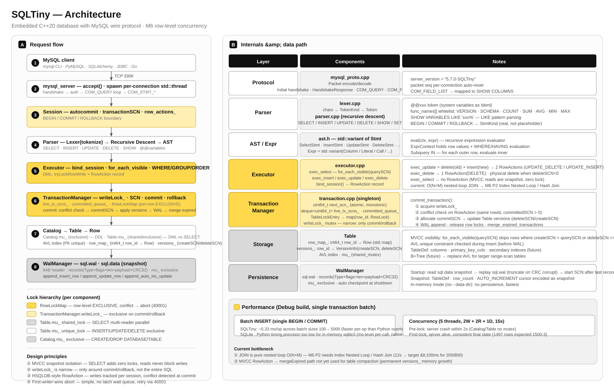

# SQLTiny — 轻量级嵌入式数据库 · MySQL 协议兼容


**SQLTiny** 是用现代 C++20 从零重写的轻量级关系型数据库,核心设计灵感来自 [HSQLDB](http://hsqldb.org/),额外暴露 **MySQL Wire Protocol**——标准 MySQL 客户端(`mysql` CLI、Navicat、DBeaver、Connector/J、PyMySQL)直接连接。

> 完整项目规划见 [`CODEPLAN.md`](./CODEPLAN.md),架构映射、技术选型、里程碑验收都在里面。

---

## ✨ 特点

| 特性 | 说明 |
|---|---|
| 🧠 **纯 C++20** | 无 Java / SQLite / RocksDB 依赖 |
| 🗄️ **嵌入式优先** | 进程内 C++ 调用 或 TCP 客户端连接,两种模式 |
| 🎯 **MySQL 协议兼容** | PyMySQL / mysql CLI / Navicat 直连,握手 + 类型推断 + NULL 编解码完整 |
| 🗃️ **多库 Catalog** | CREATE/DROP/USE DATABASE,库级独立表注册 |
| ⚡ **AVL 内存索引** | 自带平衡 BST,主键查询 O(log n) |
| 🪶 **轻量** | 单库文件,启动毫秒级,依赖仅 fmtlib |

---

## 🏛️ 系统架构

```mermaid
flowchart LR
    Client[MySQL Client<br/>PyMySQL · CLI · Navicat · SQLAlchemy]
    Server[mysql_server<br/>accept() · per-connection thread]
    Session[Session<br/>autocommit · transactionSCN]
    Parser[Parser<br/>Lexer tokenize → Recursive Descent → AST]
    Executor[Executor<br/>bind_session · for_each_visible]
    TM[TransactionManager<br/>writeLock_ · SCN · RowLockMap]
    Catalog[Catalog → Table → Row<br/>AVL index · versions_]
    WAL[WalManager<br/>sql.wal · sql.data snapshot]
    Client -->|TCP 3306| Server
    Server --> Session
    Session --> Parser
    Parser --> Executor
    Executor --> TM
    Executor --> Catalog
    TM --> Catalog
    TM --> WAL
    Catalog --> WAL
```



> 🔒 **锁分层**: Catalog.mu_(DDL) → Table.mu_ shared_lock(SELECT 多读者并行) / unique_lock(DML 独占) → RowLockMap(行级冲突检测) → TransactionManager.writeLock_(提交边界) → WalManager.mu_(WAL 文件读写)
>
> 🧊 **MVCC**: SELECT 完全不加锁,靠 `for_each_visible(querySCN)` 过滤 `createSCN ≤ querySCN < deleteSCN`,快照隔离零锁读取

---

## 🏗️ 当前进度

| 里程碑 | 状态 | 说明 |
|---|---|---|
| M1 基础骨架 | ✅ | 类型系统 + AVL + Lexer |
| M2 Catalog + DDL/DML | ✅ | Parser + AST + 执行器 |
| M2.5 MySQL 协议 | ✅ | Wire Protocol 握手 + 编解码 + TCP server |
| M3 子查询 + JOIN 补全 | ✅ | GROUP BY · HAVING · 子查询 IN · INSERT SELECT · INNER/LEFT JOIN |
| M4 协议层补全 | ✅ | Catalog 多库化 · SHOW 系列(含 LIKE) · SQLAlchemy 系统变量兼容 |
| **M5 持久化 + MVCC + SQLAlchemy** | ✅ | WAL+Replay+Checkpoint · MVCC SCN 可见性 · AUTO_INCREMENT · 全局 mutex 并发安全 · **SQLAlchemy 8/10 核心路径 PASS · 4 个集成测试** |
| **M6 行锁 + 事务 + JOIN 优化** | 📋 | 行级锁替换全局 mutex → 真正事务 → JOIN 索引优化 → 存储过程 |

---

## 🛠️ 构建

### 环境要求
- **Windows**: Visual Studio 2022 MSVC 14.40+ (MSBuild)
- **CMake**: 3.20+
- **vcpkg**: 设 `VCPKG_ROOT` 环境变量;依赖仅 `fmt` (vcpkg manifest 自动拉取)
- **Python 3.10+** (跑 PyMySQL 全场景测试可选)

```powershell
cmake --preset windows-vcpkg
cmake --build build --config Debug
```

### 构建产物

| 产物 | 类型 | 说明 |
|---|---|---|
| `build/Debug/sqltiny.lib` | 静态库 | 引擎核心,嵌入式进程内调用 |
| `build/Debug/sqltiny_server.exe` | 可执行 | MySQL 协议 TCP 服务器 |
| `build/Debug/smoke_m1.exe` | 冒烟测试 | Value / AVL / Lexer — **3/3 PASS** |
| `build/Debug/smoke_m2.exe` | 冒烟测试 | CRUD / 聚合 / 表达式 / DDL / NULL — **5/5 PASS** |
| `build/Debug/smoke_m3.exe` | 冒烟测试 | GROUP BY / HAVING / 子查询 IN / INSERT SELECT — **4/4 PASS** |
| `build/Debug/smoke_m4.exe` | 冒烟测试 | CREATE/DROP DB / USE / SHOW / SET 占位 — **6/6 PASS** |
| `build/Debug/smoke_m5_wal.exe` | 冒烟测试 | WAL Replay + CRC 校验 + Checkpoint 恢复 — **28/28 PASS** |
| `build/Debug/smoke_m25_e2e.exe` | E2E 测试 | Winsock 直连 server — **13/13 PASS** |
| `tests/test_full_flow.py` | PyMySQL 全场景 | 建库→建表→插入→查询(含 JOIN/聚合/NULL)→更新→删除→错误路径→删库 — **17/17 PASS** |
| `tests/test_sqlalchemy.py` | SQLAlchemy 2.x | Engine/Core/ORM/Inspector/持久化重连 — **8/10 PASS**(2 非核心 FAIL:DESCRIBE / SHOW FULL TABLES) |
| `tests/test_vs_sqlite.py` | 行为对比 | 同一逻辑 SQLTiny vs SQLite 全场景 assert — **全绿** |
| `tests/test_perf_vs_sqlite.py` | 性能对比 | 200 users + 800 orders INSERT + JOIN 性能 — **跑通无 crash** |
| `tests/test_concurrency.py` | 并发安全 | 5 线程(2W+2R+1D)15s 并发读写 — **通过** |

### 一键跑全量测试
```powershell
cmake --build build --config Debug

# C++ 单元级(无需 server,纯进程内)
.\build\Debug\smoke_m1.exe
.\build\Debug\smoke_m2.exe
.\build\Debug\smoke_m3.exe
.\build\Debug\smoke_m4.exe
.\build\Debug\smoke_m5_wal.exe

# MySQL 协议端到端(C++ Winsock client)
.\build\Debug\sqltiny_server.exe --port 3306 --user root
.\build\Debug\smoke_m25_e2e.exe

# Python 全场景(PyMySQL client,单一 connection)
pip install pymysql sqlalchemy
python tests\test_full_flow.py
python tests\test_sqlalchemy.py
python tests\test_vs_sqlite.py
python tests\test_perf_vs_sqlite.py
python tests\test_concurrency.py
```

### 测试总览 (C++ 69/69 PASS · Python 5 script PASS)
```
smoke_m1        3/3  PASS    Value / AVL / Lexer
smoke_m2        5/5  PASS    CRUD / 聚合 / 表达式 / DDL edge / IS NULL
smoke_m3        4/4  PASS    GROUP BY / HAVING / 子查询 IN / INSERT SELECT
smoke_m4        6/6  PASS    CREATE/DROP DB / USE / SHOW / SET 占位
smoke_m5_wal   28/28 PASS    WAL Replay + CRC + Checkpoint + 启动恢复
smoke_m25_e2e  13/13 PASS    MySQL wire C++ client E2E
test_full_flow 17/17 PASS    PyMySQL 全场景:建库→建表→插入→查询(含NULL/聚合/JOIN)→更新→删除→错误路径→删库
test_sqlalchemy 8/10 PASS    SQLAlchemy Engine/Core/ORM/Inspector (2 FAIL:DESCRIBE + SHOW FULL TABLES → M6 P1)
test_vs_sqlite  全绿          同逻辑 SQLTiny vs SQLite 行为一致
test_perf_vs_sqlite 跑通      200 users / 800 orders INSERT + JOIN 性能对比
test_concurrency 通过         5 线程 15s 并发,全局 mutex 防 crash
```

---

## 🚀 使用方式

### 方式 A:C++ 嵌入式调用(进程内,无协议开销)

```cpp
#include "core/session.h"

sqltiny::core::Session s;
auto r = s.execute("CREATE DATABASE shop");
r = s.execute("USE shop");
r = s.execute("CREATE TABLE users (id BIGINT PRIMARY KEY AUTO_INCREMENT, name VARCHAR(64) NOT NULL, age INT DEFAULT 18)");
r = s.execute("INSERT INTO users (name, age) VALUES ('Alice', 28), ('Bob', 32), ('Eve', NULL)");
r = s.execute("SELECT name, age FROM users WHERE age > 28 ORDER BY age");
// r.column_names = {"name", "age"}
// r.rows[0] = {Value("Bob"), Value(32)}
```

### 方式 B:TCP server + mysql / PyMySQL 客户端

```powershell
# 启动 server (开发期不校验密码,user=root 即可登录)
.\build\Debug\sqltiny_server.exe --port 3306 --user root

# mysql CLI 连接
mysql -h 127.0.0.1 -P 3306 -u root

# 或 Python PyMySQL
python -c "import pymysql; c=pymysql.connect(host='127.0.0.1',port=3306,user='root'); cur=c.cursor(); cur.execute('SELECT 1'); print(cur.fetchone())"
```

### CLI 参数

```
sqltiny_server [--port <n>] [--user <name>] [--password <pwd>] [--data-dir <DIR>]
               默认 --port 3306 --user root
               --data-dir  缺省 = 内存模式(无持久化,重启丢数据)
```

> **开发期简化**: `mysql_native_password` 不校验密码,只要 user=root 就放行。

### 数据存储位置

SQLTiny 通过 `--data-dir` 指定持久化目录,目录下生成两个文件:

| 文件 | 说明 |
|---|---|
| `sql.wal` | 写前日志(WAL),所有 INSERT / UPDATE / DELETE / DDL 实时追加。Server 启动时先读 `sql.data` 再 replay 这个 WAL |
| `sql.data` | Snapshot 快照,由 checkpoint 时从 Catalog 全量 dump 生成。Server 正常 shutdown 自动做 checkpoint |

**三种运行模式**:

```powershell
# 1. 内存模式 (默认,不传 --data-dir)
#    不写磁盘,重启丢数据,适合开发调试
.\build\Debug\sqltiny_server.exe --port 3306 --user root

# 2. 指定持久化目录 (最常用)
#    第一次启动自动创建目录,生成 sql.wal + sql.data
.\build\Debug\sqltiny_server.exe --port 3306 --user root --data-dir D:\SQLTiny\data

# 3. 自定义位置 (相对或绝对路径都可以)
.\build\Debug\sqltiny_server.exe --port 3306 --user root --data-dir .\sqltiny_data
```

**修改存储位置**:停 server → 换 `--data-dir` 参数重启即可。新目录自动创建并初始化空 WAL。如果想迁移旧数据,直接把旧目录下的 `sql.wal` / `sql.data` 复制到新目录,Server 启动时会自动 replay。

> 注意:Server 正在运行时不要手动删除或修改 `sql.wal` / `sql.data`,会导致下次启动数据丢失或损坏。

### 当前支持的 SQL 子集

| 类别 | 语法 | 备注 |
|---|---|---|
| **多库 DDL** | `CREATE DATABASE [IF NOT EXISTS]` / `DROP DATABASE [IF EXISTS]` / `USE db` | Catalog 多库化,库级独立表 |
| **表 DDL** | `CREATE TABLE t(...) [IF NOT EXISTS]` / `DROP TABLE [IF EXISTS]` | PRIMARY KEY / AUTO_INCREMENT / DEFAULT / NOT NULL |
| **DML** | `INSERT INTO t VALUES(…, …)` / 多行 / 指定列 / `UPDATE t SET x=… WHERE …` / `DELETE FROM t WHERE …` | 显式 NULL 不被补 DEFAULT |
| **查询** | `SELECT cols FROM t WHERE … ORDER BY … LIMIT n` | IS NULL / IS NOT NULL / LIKE / IN / 比较运算 / AND / OR / NOT |
| **聚合** | `COUNT(*)` / `COUNT(col)` / `SUM` / `AVG` / `MIN` / `MAX` | GROUP BY + HAVING 完整 |
| **表连接** | INNER JOIN / LEFT JOIN / CROSS JOIN / 多 JOIN 链 | 别名限定列 + LEFT JOIN 保留 NULL 行 |
| **子查询** | `WHERE col IN (SELECT …)` | 标量子查询 |
| **SHOW** | `SHOW DATABASES` / `SHOW TABLES` / `SHOW COLUMNS FROM t` / `SHOW CREATE TABLE t` / `SHOW STATUS` / `SHOW VARIABLES [LIKE pattern]` | LIKE 支持 `%xxx%` / `xxx%` / `%xxx` / 精确匹配 |
| **系统** | `SET NAMES utf8mb4` / `SET AUTOCOMMIT = ON` | 占位实现(满足 SQLAlchemy / PyMySQL 初始化) |
| **事务** | `BEGIN` / `COMMIT` / `ROLLBACK` | 目前 parser 占位(语义正确但无 undo-log,所有 SQL 在全局 mutex 下串行化)→ M6 P1 完整化 |
| **并发安全** | `Session::execute` 入口全局 `std::mutex` | 多线程 server 不 crash,但吞吐为 1(每行锁 → M6 P0) |

### 已验证 SQL 示例

```sql
-- ============ 多库生命周期 ============
CREATE DATABASE shop;
USE shop;

CREATE TABLE users (id BIGINT PRIMARY KEY AUTO_INCREMENT,
                    name VARCHAR(64) NOT NULL,
                    age INT DEFAULT 18,
                    dept_id INT);
CREATE TABLE orders (id INT PRIMARY KEY AUTO_INCREMENT,
                     user_id INT, total DECIMAL(10,2) NOT NULL,
                     status VARCHAR(16) DEFAULT 'pending');

-- 插入含显式 NULL 的行
INSERT INTO users (name, age, dept_id) VALUES
  ('Alice', 28, 1), ('Bob', 32, 1), ('Charlie', 25, 2),
  ('Diana', 40, 2), ('Eve', NULL, NULL);

-- ============ 查询 ============
SELECT * FROM users ORDER BY id;                      -- Eve age=NULL 能正确返回
SELECT COUNT(*), SUM(age), AVG(age) FROM users;       -- 5, 125, 31.25 (PyMySQL 正确类型)
SELECT dept_id, COUNT(*), AVG(age) FROM users
  GROUP BY dept_id HAVING SUM(age) > 30;

-- ============ JOIN ============
SELECT u.name, o.total FROM users u
  INNER JOIN orders o ON o.user_id = u.id;

SELECT u.name, o.id, o.total FROM users u
  LEFT JOIN orders o ON o.user_id = u.id;             -- Eve 无订单, o.* 返回 NULL 行

-- ============ 更新 / 删除 ============
UPDATE users SET age = 30 WHERE name = 'Eve';
DELETE FROM users WHERE age < 30;

-- ============ 清理 ============
USE default;
DROP DATABASE shop;
```

---

## 📁 目录结构

```
SQLTiny/
├── CMakeLists.txt             顶层构建
├── CODEPLAN.md                完整项目规划(架构映射 + 里程碑)
├── README.md                  本文件
├── vcpkg.json                 vcpkg manifest(仅依赖 fmt)
├── src/
│   ├── types/                 SqlType + Value 运行时值 + MySQL 协议类型映射
│   ├── parser/                Lexer + AST + 递归下降 Parser(支持多库/多 JOIN)
│   ├── storage/               AVL 内存索引 + 表存储
│   ├── catalog/               Catalog 多库化 (databases_[db].tables_)
│   ├── core/                  Database / Session 入口
│   ├── executor/              Executor + infer_type() 静态类型推断 + 内置函数
│   └── net/                   MySQL Wire Protocol 编解码(field_type 动态推断) + TCP server
└── tests/
    ├── smoke_m1.cpp           Value / AVL / Lexer 冒烟
    ├── smoke_m2.cpp           CRUD / 聚合 / 表达式 / DDL / NULL
    ├── smoke_m3.cpp           GROUP BY / HAVING / 子查询 IN / INSERT SELECT
    ├── smoke_m4.cpp           CREATE/DROP DB / USE / SHOW / SET 占位
    ├── smoke_m5_wal.cpp       WAL Replay + CRC + Checkpoint 恢复
    ├── smoke_m25_e2e.cpp      Winsock 直连 server E2E
    ├── test_full_flow.py      PyMySQL 全场景用户测试
    ├── test_sqlalchemy.py     SQLAlchemy 2.x Engine/Core/ORM/Inspector
    ├── test_vs_sqlite.py      SQLTiny vs SQLite 行为对比
    ├── test_perf_vs_sqlite.py 大数据量 INSERT + JOIN 性能对比
    └── test_concurrency.py    多线程并发读写(全局 mutex 验证)
```

---

## ❓ 常见问题

**Q: 启动 mysql 客户端时报错 `Can't connect`?**
A: 确认 `sqltiny_server.exe` 正在运行,监听 3306 端口:
```powershell
netstat -ano | findstr :3306
```

**Q: PyMySQL 连时报 `invalid literal for int()`?**
A: M4 前 version 字符串以 `SQLTiny-` 开头,PyMySQL 解析 version 失败。M4 已修成 `5.7.0-SQLTiny`。如果还有这个错,确认是最新 build。

**Q: PyMySQL 报 `Packet sequence number wrong` / `InterfaceError (0, '')`?**
A: 这通常是前一个查询没正确处理错误包导致连接状态不同步。重新建立连接即可;也可以先 `conn.ping(reconnect=True)`。

**Q: 密码登录失败?**
A: 开发期不校验密码,user 必须是 `root`,密码任意填(`mysql -u root -p` 直接回车也行)。

**Q: 支持哪些 MySQL 版本?**
A: 协议层按 MySQL 8.0 Client 41 实现,`mysql` CLI / Navicat / DBeaver / Connector/J / PyMySQL 均已验证。

---

## 📜 许可证

Apache License 2.0 — 见 [`LICENSE`](./LICENSE) 文件。

## 🤝 致谢

- [HSQLDB](http://hsqldb.org/) — 架构和数据结构的重要参考(AVL 索引、MVCC、Session 分层)
- [MySQL Wire Protocol](https://dev.mysql.com/doc/dev/mysql-server/latest/) — 协议层参考
